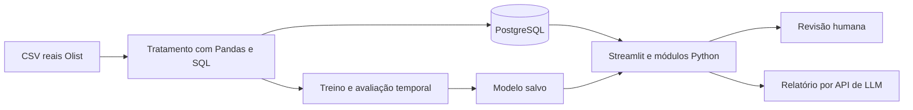

# Desenvolvimento do EntregaCerta AI

Histórico técnico acumulado desde 05/11/2026. Para executar o sistema, siga
[o guia atual](instalacao_novo_pc.md).
Os caminhos/comandos das entradas antigas documentam o estado de cada experimento;
não são uma sequência de inicialização da versão atual.

## Estado atual e diagramas — 18/11/2026

O sistema usa HTML/CSS/JavaScript, FastAPI e PostgreSQL. O modelo ativo é o
CatBoost VER0.7 no checkpoint D−1; prioriza por dia 65% dos pedidos pendentes,
arredondando para cima. A loja demonstrativa continua separada do ML.
Detalhes e limitações em [modelo_ver07.md](modelo_ver07.md).

Infraestrutura local implementada com **Terraform + Docker**: aplicação na porta
8001 e PostgreSQL existente importado, com volume preservado. O modo Python na
porta 8000 continua disponível. Instruções no [guia de execução](instalacao_novo_pc.md).

Diagramas atualizados: [BPMN](diagramas/processo.svg), [DER](diagramas/der.svg) e
[arquitetura](diagramas/arquitetura.svg). Fontes editáveis: [processo.bpmn](diagramas/processo.bpmn),
[der.drawio](diagramas/der.drawio) e [arquitetura.drawio](diagramas/arquitetura.drawio).
Há PNG de cada diagrama para os slides. A seção de 18/11 ao final documenta
as fontes, verificações e como editá-los.

**Artigo dispensado pela equipe em 18/11/2026.** Menções a artigo nas entradas
anteriores são histórico do planejamento, não uma pendência atual.
Continuam a documentação técnica, slides e demonstração. Os esboços iniciais
abaixo foram preservados; não descrevem a arquitetura ou o status atuais.

## Problema e dados — planejamento inicial

Priorizar pedidos que merecem acompanhamento humano por risco de entrega após o dia prometido. A previsão será feita com informações disponíveis na aprovação; a demonstração será uma reprodução histórica.

Fonte: [Brazilian E-Commerce Public Dataset by Olist](https://www.kaggle.com/datasets/olistbr/brazilian-ecommerce), registros reais e anonimizados do comércio eletrônico brasileiro de 2016 a 2018. Licença publicada: CC BY-NC-SA 4.0; preservar atribuição e condições. O recebimento e o hash do ZIP estão em `recebimento_dataset.txt`. Os nove originais estão em `Dados/Brazilian Logistic/`; a consolidação está em `Dados/pedidos_consolidados.csv`.

Unidade: um pedido, agregando seus itens. Positivo: dia da entrega efetiva posterior ao dia prometido. Entrega no mesmo dia é pontual. Cancelados e casos sem desfecho não são rotulados automaticamente como pontuais; o estudo inicial se limita aos entregues elegíveis.

Usar preço/frete informado, composição do pedido, categoria, peso/dimensões, UFs e prazo/calendário quando adequados. Entrega efetiva, passagem à transportadora, status final e avaliações posteriores ficam fora da entrada do modelo. A fonte não tem versões históricas: a disponibilidade dos cadastros e da promessa na aprovação é uma hipótese a documentar.

## Arquitetura inicial — histórico



Backend em módulos Python e interface Streamlit na mesma aplicação. PyTorch entra em uma rede pequena para comparação; Scikit-learn cobre pré-processamento, referências e modelos clássicos. O modelo final será escolhido pela validação, não pela complexidade da ferramenta.

Na época deste planejamento, o BPMN representava a previsão na aprovação.
`processo.bpmn` e `processo.png` foram atualizados em 18/11/2026 para o fluxo
implementado em D−1. A infraestrutura Terraform foi implementada depois, no
mesmo dia, conforme registro ao final deste documento.

## Roadmap inicial e modo de trabalho — histórico

| Etapa | Trabalho e entrega | Estado |
|---|---|---|
| 1. Escolha | Proposta EntregaCerta e fonte Olist | Escolhidas |
| 2. Preparação simples | Estrutura, ambiente, dependências e conexão PostgreSQL | Estrutura e Pandas verificados; stack completa e conexão pendentes |
| 3. Dados e SQL | Pandas, limpeza, junções, EDA, carga PostgreSQL e divisão temporal | Consolidação, tratamento e divisão temporal executados; EDA relacional e carga SQL pendentes |
| 4. ML | Baselines, modelos Scikit-learn/PyTorch, avaliação e inferência salva | Matrizes e pré-processador prontos; modelos preditivos ainda não treinados |
| 5. GenAI | Relatórios com fatos, conhecimento, API e testes de indisponibilidade | Não iniciada |
| 6. Aplicação | Interface, filtros, gráficos, previsão real, revisão e relatório | Não iniciada |
| 7. Entrega | Testes, Terraform, artigo, slides, demonstração e repositório remoto | Não iniciada |

Para implementar com orientação: **Nos guie pela etapa N, para implementarmos.** Para delegar: **Execute integralmente a etapa N.** Executar a etapa pedida e registrar arquivos, comandos, resultados e pendências, sem iniciar automaticamente a próxima.

## Regras de avaliação e confiabilidade

- Protocolo original: treino e avaliação somente reais. Em 11/11/2026, a equipe autorizou um experimento separado com CTGAN no treino; validação e teste permanecem reais. Não promover os sintéticos à base operacional nem apresentá-los como registros observados.
- Dividir pelo tempo, respeitar quando os rótulos eram conhecidos e ajustar transformações somente no treino. Reservar o teste final.
- Comparar baseline e modelos; avaliar Precision, Recall, F1, matriz de confusão, Average Precision/curva PR e qualidade da fila. Examinar falsos positivos e negativos.
- Definir a política de prioridade no desenvolvimento; os 10% inicialmente propostos são hipótese acadêmica de capacidade, não limiar empresarial comprovado.
- Mostrar probabilidade apenas se a calibração sustentar essa interpretação. Não inventar resultados, causas ou ROI.
- A LLM redige a partir dos fatos do sistema. ML e painéis continuam funcionando se a API falhar. Decisões permanecem humanas.

## Entregáveis e registro de 05/11/2026 — histórico

### Dataset consolidado em 05/11/2026

O script `src/preparar_dados.py` gera um único CSV com **99.441 linhas e 53 colunas**, mantendo todos os pedidos originais, inclusive aqueles sem itens ou pagamentos correspondentes. Não modifica os nove CSVs de origem. O registro de execução e os hashes SHA-256 estão em `Docs/validacao_dados.txt`.

Executar na raiz do projeto:

```powershell
.\.venv\Scripts\python.exe src\preparar_dados.py
.\.venv\Scripts\python.exe -m unittest discover -s tests -v
```

Na execução de 05/11/2026, os cinco testes com registros reais passaram: preservação de pedidos/itens, reconciliação financeira com Decimal, datas originais e rótulos, pesos incompletos e distância de um pedido com vários vendedores e quantidades diferentes de itens. Os testes não são evidência de desempenho preditivo.

A consolidação usa sete fontes: pedidos, itens, pagamentos, produtos, clientes, vendedores e geolocalização. Avaliações continuam separadas para análises retrospectivas; a tradução das categorias não foi necessária porque seus nomes em português foram preservados.

| Grupo de colunas | Significado e regra |
|---|---|
| `order_*`, `customer_id` | Campos originais de pedidos; datas e status final são preservados para auditoria, não selecionados automaticamente como entradas. |
| `customer_unique_id`, `customer_city`, `customer_state`, `customer_zip_code_prefix` | Identificação anonimizada e localização do cliente; CEP é identificador de cinco dígitos. |
| `customer_latitude`, `customer_longitude` | Coordenadas aproximadas pela mediana dos pontos do prefixo de CEP; não representam o endereço exato. |
| `quantidade_itens`, `quantidade_produtos`, `quantidade_vendedores` | Número de linhas de itens, produtos distintos e vendedores distintos por pedido. Pedidos com vários vendedores são mantidos. |
| `categoria_principal`, `quantidade_categorias`, `itens_sem_categoria` | Categoria conhecida com mais itens, desempate alfabético; contagem de categorias conhecidas e de itens sem categoria. |
| `valor_itens`, `valor_frete`, `valor_pago` | Somas independentes de itens/frete e pagamentos; sem multiplicar os valores por junções entre tabelas de vários registros por pedido. |
| `peso_total_g`, `volume_total_cm3`, `itens_sem_peso`, `itens_sem_dimensoes` | Somas por item. Peso não positivo e medidas incompletas são desconhecidos para os derivados; o total fica ausente quando qualquer item não tem medida válida. |
| `uf_origem`, `quantidade_ufs_origem`, `vendedores_sem_uf`, `vendedores_ids` | UF comum aos vendedores conhecidos, `MULTIPLAS` quando há várias UFs, ou ausente se falta alguma UF. IDs separados por `\|` servem para rastreabilidade, não como entrada direta. |
| `distancia_media_vendedores_km`, `distancia_max_vendedores_km`, `vendedores_sem_distancia` | Distâncias geodésicas aproximadas por Haversine, uma contribuição por vendedor, sem ponderar pelo número de itens. Não são percursos rodoviários. Média/máximo usam as distâncias conhecidas; o contador informa a cobertura incompleta. |
| `quantidade_pagamentos`, `quantidade_formas_pagamento`, `parcelas_maximas`, `tipo_pagamento_principal` | Registros de pagamento, tipos distintos e maior número de parcelas. Tipo principal é o de maior valor total pago, com desempate alfabético. Quantidade de pagamentos não significa quantidade de parcelas. |
| `prazo_prometido_dias`, `tempo_aprovacao_horas`, `dia_semana_aprovacao`, `mes_aprovacao`, `hora_aprovacao` | Prazo em dias de calendário desde a aprovação, horas entre compra e aprovação e calendário da aprovação. Dia da semana: segunda = 0, domingo = 6. |
| `diferenca_entrega_prazo_dias`, `dias_atraso`, `atrasou`, `rotulo_disponivel` | Desfechos retrospectivos: diferença entre os dias de entrega ao cliente e promessa; atraso é essa diferença limitada a zero no mínimo. `atrasou`: 1 = atraso, 0 = pontual, vazio = sem rótulo observado válido. |
| `elegivel_modelagem`, `entrega_anterior_aprovacao`, `prazo_anterior_aprovacao` | Flags retrospectivas para seleção e auditoria. Elegibilidade inicial exige rótulo observado, aprovação conhecida e cronologia básica coerente; não substitui a avaliação de viés nem a divisão temporal. |
| `tempo_ate_despacho_dias`, `tempo_transporte_dias`, `tempo_entrega_dias` | Durações retrospectivas em dias de 24 horas, preservando frações. Durações negativas ficam indefinidas; timestamps originais permanecem disponíveis para investigar inconsistências. |

Os rótulos são calculados somente para status `delivered`, com entrega, promessa e compra conhecidas, sem entrega anterior à compra. Há **96.470 rótulos observados**, **2.971 pedidos sem rótulo** e **96.394 inicialmente elegíveis para modelagem**. As diferenças decorrem de ausência de desfecho e inconsistências cronológicas; nenhum caso recebeu data ou rótulo inferido por LLM. Pedidos sem rótulo não são negativos.

O CSV é uma **base de análise**, que também contém desfechos e campos posteriores. No treinamento futuro, usar uma seleção explícita: `COLUNAS_PREVISAO`, definida no script, contém 29 entradas candidatas; não usar todas as colunas restantes após retirar apenas o alvo. A disponibilidade de pagamentos, itens, cadastros e promessa na aprovação é uma hipótese, pois a fonte não possui snapshots históricos completos. Históricos de atraso por vendedor/rota ainda não foram calculados: precisam respeitar quando cada desfecho se tornou conhecido.

Há 775 pedidos sem itens, um sem pagamento e 1.278 com vários vendedores. Ausências não foram preenchidas por zero. Ainda faltam EDA completa, tratamento orientado à modelagem, carga PostgreSQL e divisão temporal. Não foi treinado nenhum modelo nesta tarefa.

Manter README, este documento, prompts de desenvolvimento/aplicação, BPMN editável e arquitetura. Ao final: código e dados reproduzíveis conforme licença, testes essenciais, Terraform executado, artigo PDF de até dez páginas, slides/roteiro para até vinte minutos e backup da demonstração.

Nesta reorganização foram criadas as pastas simples, consolidada a documentação e preservados o ambiente, a proveniência e o histórico anterior. Os testes da estrutura antiga não validam PostgreSQL/PyTorch nem uma aplicação futura. A cópia de segurança está na pasta vizinha `EntregaCertaAI_Anterior_884a61b`.

## Registro para o artigo e a apresentação

Checkpoint de 05/11/2026, solicitado pela equipe para preservar as decisões e evidências que serão usadas no artigo PDF de 8 a 10 páginas e na apresentação de até 20 minutos. Este documento é a referência central; `validacao_dados.txt` registra a execução da consolidação e `prompts.txt` guarda os pedidos e decisões de desenvolvimento.

| Assunto | O que podemos registrar neste momento |
|---|---|
| Problema e público | Apoiar analistas de logística de e-commerce na priorização de pedidos com risco de atraso, com revisão humana. |
| Proposta aprovada | EntregaCerta AI com dados reais e anonimizados da Olist. Previsão na aprovação do pedido; demonstração histórica, sem alegar implantação empresarial. |
| Metodologia executada | Leitura dos CSVs com Pandas; agregação de itens/pagamentos antes das junções; uma linha por pedido; produtos e localizações; distância geográfica aproximada; rótulos a partir de datas observadas. |
| Evidência de qualidade | 99.441 pedidos, 53 colunas, zero pedidos duplicados, totais monetários reconciliados e nove originais preservados. Cinco testes com registros reais passaram na geração documentada. |
| Cobertura dos rótulos | 96.470 rótulos observados, 2.971 sem rótulo e 96.394 inicialmente elegíveis para modelagem. Informar qual população sustenta cada resultado futuro. |
| Limitações essenciais | Dados de 2016-2018, cobertura restrita a entregas elegíveis, inconsistências cronológicas, atributos sem snapshots históricos e distâncias por prefixo de CEP. Associações não comprovam causas nem ganhos operacionais. |
| Modelos propostos, ainda não treinados | Regressão Logística como referência e HistGradientBoostingClassifier como principal candidato. MLP em PyTorch como comparação fundamentada. Estimativa da duração do atraso por regressão é uma extensão a validar. |
| Próximo trabalho | EDA, revisão de ausências e inconsistências, seleção explícita de entradas disponíveis na aprovação e divisão temporal. Ajustar transformações somente no treino e preservar o teste final. Carga PostgreSQL também permanece pendente. |
| Resultados ainda inexistentes | Não há desempenho de modelo, aplicação operacional, integração GenAI validada, ROI medido ou redução de atrasos demonstrada. Essas seções do artigo e dos slides só receberão resultados após execução. |

### Identificação do arquivo atualmente disponível

Na conferência deste checkpoint, o arquivo disponível é `Dados/pedidos_consolidados_teste.csv`, com 47.996.599 bytes. Sua leitura confirmou novamente 99.441 linhas, 53 colunas, zero pedidos duplicados e as contagens de rótulos acima. Os cinco testes da geração anterior não foram reexecutados nesta conferência.

- SHA-256 do CSV atual: `d9358143c89395d511effbd99da8dae454fe5824577072916b9a13628bd3e180`.
- SHA-256 de `src/preparar_dados.py`: `7AF45872F24B55013F56856D25231117B21649FC1D0111BF6FE5727EEB589A0F`.
- SHA-256 de `tests/test_preparar_dados.py`: `88670F08293216DDB0140FACAB1A0F6D9D2823148FB6B853D41C96131A497A22`.
- Ambiente conferido: Python 3.12.14. A geração documentada usou Pandas 3.1.0 e NumPy 2.5.4.

O script e os testes continuam apontando para o nome padrão `Dados/pedidos_consolidados.csv`. Ao retomá-los, gerar esse caminho com o script ou adaptar explicitamente a leitura para a cópia escolhida; não substituir silenciosamente um arquivo de trabalho da equipe. Igualdade de contagens não comprova igualdade integral entre arquivos.

### Registro obrigatório ao concluir as próximas etapas

Atualizar este documento com objetivo, decisão e justificativa, arquivos utilizados/alterados, versão ou hash da base, comandos e ambiente, verificações executadas, resultados e limitações. Manter o histórico de resultados anteriores quando o protocolo ou a base mudar, identificando a mudança.

Para os experimentos, guardar datas de corte e populações de treino/validação/teste, seleção de atributos, tratamento aprendido no treino, algoritmo/hiperparâmetros/semente, critério de limiar, métricas e gráficos efetivamente calculados. Diferenciar proposta, hipótese, resultado observado e projeção financeira. Registrar também tentativas com desempenho insatisfatório e os motivos para manter ou descartar um modelo.

Para GenAI e aplicação, registrar prompts, contexto fornecido, testes de confiabilidade e falha da API, versões da arquitetura/BPMN e fluxo demonstrável. Essas evidências alimentarão o artigo e o PowerPoint quando essas entregas forem solicitadas; este checkpoint não significa que já tenham sido produzidos.

## Tratamento para testes de ML — 05/11/2026

Executado `src/tratar_dados_ml.py` sobre `Dados/pedidos_consolidados_teste.csv`, preservando seu conteúdo e os originais. O script gera:

- `Dados/pedidos_ml.csv`: base legível com unidades originais, imputação aprendida no treino, indicadores de ausência, alvos e identificação da partição.
- `Modelos/dados_ml.joblib`: matrizes numéricas prontas, alvos de classificação/duração, metadados e o pré-processador ajustado somente no treino.
- `Docs/tratamento_ml.txt`: registro completo de exclusões, ausências, versões, cortes, contagens e hashes de entrada/saída.

### População, datas e exclusões

Das 99.441 linhas, foram excluídos sequencialmente 2.963 pedidos sem status `delivered`, 22 com datas essenciais ausentes, 61 com entrega anterior à aprovação e um com promessa anterior ao dia da aprovação. Não houve duplicatas idênticas removidas nem exclusões adicionais por ausência de itens. Restaram 96.394 pedidos na coorte básica. Os rótulos existentes foram confrontados com as datas reais, sem imputação ou reclassificação por IA.

Foram definidos cortes calendários antes de avaliar qualquer modelo: **01/01/2018** para início da validação e **01/05/2018** para início do teste. A referência é a data de aprovação; a disponibilidade conservadora do rótulo é a data real de entrega ao cliente. Para poder usar os resultados no momento simulado, foram retirados 2.439 pedidos do treino cujo rótulo só seria conhecido após seu corte e 2.565 da validação cujo rótulo só seria conhecido após o início do teste. Esses 5.004 registros permanecem na base de origem.

| Partição | Pedidos utilizados | Atrasos observados | Proporção da classe positiva |
|---|---:|---:|---:|
| Treino | 41.173 | 1.765 | 4,29% |
| Validação | 24.667 | 2.494 | 10,11% |
| Teste | 25.550 | 1.124 | 4,40% |
| Total | 91.390 | 5.383 | — |

Essas proporções descrevem os dados, não o desempenho de um modelo. A diferença entre períodos e a seleção de entregues exigem discussão de representatividade. A purga de rótulos ainda indisponíveis é conservadora, mas pode sub-representar entregas demoradas junto às fronteiras temporais. Não mover os cortes para melhorar métricas. Validação serve ao desenvolvimento; teste fica reservado para a avaliação final.

Existem 367 pedidos de validação e 290 de teste de clientes que também aparecem no treino. IDs de pedido, cliente e vendedor ficam fora das entradas. O objetivo desta divisão é prever novos pedidos ao longo do tempo, incluindo clientes conhecidos; ela não comprova desempenho em uma população exclusivamente de clientes novos.

### Transformações efetivamente executadas

1. Conferência de duplicatas e chaves; parsing de datas e seleção por cronologia e desfecho observado.
2. Revisão geográfica: foram encontrados pontos como latitude 42°N associados a clientes brasileiros. Excluídos **31 pontos da fonte de geolocalização** fora de um retângulo conservador de latitude −34 a 6 e longitude −74 a −28; esse intervalo inclui ilhas oceânicas e é uma hipótese de controle de qualidade, não uma malha territorial. Recalculadas medianas por prefixo de CEP e distâncias por vendedor; **47 pedidos da coorte básica** tiveram a distância máxima alterada ou tornada desconhecida. Não foram inventadas coordenadas. A referência dos extremos é o [Anuário do IBGE](https://anuario.ibge.gov.br/images/aeb/2024/s1/2_pdf/s1t1101.pdf). Pontos dentro do retângulo ainda podem estar incorretos.
3. Normalização de categorias e UFs; valores numéricos não finitos, negativos ou fora de domínios fixos tornam-se ausentes. Valores extremos válidos foram preservados; não houve cortes por quantis aprendidos na base inteira.
4. Medianas numéricas aprendidas somente no treino, com indicadores para ausências observadas nessa partição. Categorias ausentes recebem `NAO_INFORMADO`. O preenchimento de características é uma transformação técnica identificada; não cria novas observações nem desfechos.
5. Padronização numérica e codificação one-hot, ajustadas somente no treino. Categorias futuras desconhecidas são aceitas sem refazer o ajuste. São **29 características originais**, sendo quatro categóricas, e **159 atributos numéricos transformados**. O uso de transformações ajustadas apenas no treino segue a [orientação do Scikit-learn sobre vazamento](https://scikit-learn.org/stable/common_pitfalls.html).

Antes da imputação e da purga temporal, havia na coorte básica 1.331 categorias ausentes, 22 pesos totais ausentes, 16 volumes ausentes e 477 pedidos sem distâncias calculáveis; um pedido não tinha os campos de pagamento. Esses números não representam a distribuição de ausências de cada partição individual.

Não houve balanceamento artificial ou SMOTE, nem ajuste ao conjunto de teste. Pesos de classe podem ser comparados no treinamento futuro sem gerar exemplos artificiais. A disponibilidade histórica dos cadastros, itens, pagamentos e promessa na aprovação continua sendo uma hipótese da fonte.

### Execução e consumo pelos modelos

```powershell
.\.venv\Scripts\python.exe src\tratar_dados_ml.py --entrada "Dados\pedidos_consolidados_teste.csv"
.\.venv\Scripts\python.exe -m unittest discover -s tests -v
.\.venv\Scripts\python.exe -m pip check
```

O comando completo passou: **10 testes aprovados** e nenhuma dependência quebrada. As verificações incluem reconciliação dos originais, preservação dos rótulos reais, geolocalizações inválidas, separação de pedidos, disponibilidade temporal dos rótulos, medianas e categorias aprendidas apenas no treino e matrizes finitas. Na primeira execução, uma atribuição de tipos incompatíveis no Pandas 3 foi corrigida com substituição explícita das colunas antes da geração bem-sucedida.

Ambiente verificado: Python 3.12.14, Pandas 3.1.0, NumPy 2.5.4, Scikit-learn 1.9.1 e Joblib 1.6.0. Foram instaladas apenas as dependências necessárias de ML; isso não valida a stack completa, PostgreSQL ou PyTorch.

Para os testes dos algoritmos, usar as matrizes já preparadas:

```python
import joblib

dados = joblib.load("Modelos/dados_ml.joblib")
X_treino, y_treino = dados["X"]["treino"], dados["y"]["treino"]
X_validacao, y_validacao = dados["X"]["validacao"], dados["y"]["validacao"]
X_teste, y_teste = dados["X"]["teste"], dados["y"]["teste"]
```

O alvo `y` representa atraso; `y_dias_atraso` contém os dias observados, incluindo zero para pontuais. Uma regressão condicional à ocorrência de atraso deve filtrar os positivos explicitamente e ter avaliação própria.

O CSV tratado mantém categorias legíveis e contém metadados para rastreabilidade; não passar todas as suas colunas diretamente a um estimador. Ele já está imputado: não reaplicar o mesmo pré-processador sobre esse CSV descartando os indicadores, pois isso perderia a informação original de ausência. As matrizes do pacote são a entrada de referência para a comparação inicial dos modelos.

Para inferência futura com dados novos ainda não imputados, usar `limpar_atributos()` e depois `dados["preprocessador"].transform(...)`, sem chamar `fit`. A regra geográfica precisa ser respeitada na preparação dessas novas entradas. Nenhum classificador, regressor, limiar de decisão ou métrica de desempenho preditivo foi produzido nesta etapa. EDA relacional, carga PostgreSQL e treinamento permanecem trabalhos distintos.

## Preparação didática em notebook — 05/11/2026

A equipe pediu uma forma mais acessível de entender os dois scripts. Criado `Notebooks/01_preparacao_dados.ipynb`, com explicações em português, 35 células de código e no máximo 15 linhas por célula. Os scripts e os notebooks anteriores foram preservados.

O fluxo mostra diretamente leitura de sete CSVs originais, agregações e junções, conferência de dinheiro e cardinalidades, coordenadas e distâncias, atributos na aprovação, alvos observados, exclusões, limpeza, cortes temporais, imputação, escala, codificação e persistência. Não importa os scripts para esconder o processamento. Incorpora a correção geográfica já documentada, sem pretender reproduzir byte a byte o consolidado antigo.

Execução final do início ao fim: **35 células, zero erros e zero avisos salvos**. Reproduzidos 96.394 pedidos elegíveis antes da purga temporal e 91.390 na preparação final: treino 41.173, validação 24.667, teste 25.550. As matrizes têm 159 atributos; o CSV legível tem 44 colunas. Comparados todos os metadados, alvos e matrizes com o pacote anterior, com tolerância numérica de `rtol=1e-5`, `atol=1e-5` para ponto flutuante; o CSV também foi comparado. Não houve divergências.

Os dois arquivos de ML já existentes foram preservados. O notebook somente os cria se estiverem ausentes; quando existem, confere compatibilidade antes de prosseguir. Os hashes de 16 arquivos foram iguais antes e depois: nove CSVs originais, consolidado, CSV de ML, pacote Joblib, dois notebooks da equipe e dois scripts.

Dois gráficos descritivos foram gerados e inspecionados individualmente: tamanhos das partições e ausências dos atributos no treino antes da imputação. A revisão visual integral da prévia HTML no navegador ficou indisponível porque o ambiente bloqueia o protocolo local `file:`. Isso não impediu a execução nem a inspeção dos gráficos. Conferir o notebook aberto no VS Code com o kernel `.venv (Python 3.12)` continua sendo a forma de leitura para a equipe.

Validações executadas: `nbformat.validate`, execução com `nbclient` em kernel do Python 3.12 do projeto, conferência de contagens de execução consecutivas, comparação dos artefatos e hashes; `python -m unittest discover -s tests -v` aprovou os **10 testes**. `pip check` não encontrou dependências quebradas.

Instalados no `.venv`: Matplotlib 3.11.2, nbformat 5.11.1, nbclient 0.11.0 e nbconvert 7.17.2, com dependências. As três ferramentas de notebook foram acrescentadas ao `requirements.txt`; Matplotlib já estava previsto. A stack completa ainda não foi instalada ou validada. O README recebeu o acesso ao notebook e a atualização do estado dos dados.

Nenhum modelo preditivo foi treinado, nem houve carga PostgreSQL ou novas métricas de desempenho. Continuam válidas as limitações de representatividade, purga temporal, disponibilidade histórica dos atributos e distância aproximada. O próximo trabalho de ML é a comparação de baseline e modelos; a equipe pode primeiro estudar e explicar cada saída do notebook.


## Experimento CTGAN autorizado — 11/11/2026

A equipe solicitou testar aumento artificial do treino, alterando para este experimento
isolado a preferência anterior de treinar somente com dados reais. O modelo operacional
não é substituído. O notebook 02 permanece intacto; o notebook enviado foi copiado para
`Notebooks/olist_comparacao_otimizada_gmm_treino_teste.ipynb` e a adaptação está em
`Notebooks/olist_comparacao_otimizada_ctgan_postgresql.ipynb`.

A fonte é a consulta PostgreSQL da view `public.vw_pedidos_inferencia` com o alvo em
`public.pedidos`. Contagens conferidas: treino 41.173/1.765 atrasos, validação
24.667/2.494 e teste 25.550/1.124. Preservados os cortes de 01/01/2018 e 01/05/2018,
o alvo por dia e a coorte atual. A revisão proposta da disponibilidade do rótulo
não foi aplicada aqui, para não misturar mudanças no mesmo experimento.

CTGAN recebe apenas atributos dos atrasos reais de treino; o rótulo dos gerados é
condicionante sintético, não observado. Contadores e ausências são representados em
conjunto, contínuas usam log1p, candidatos fora dos intervalos de treino são rejeitados,
a distância média é igualada à máxima para um vendedor, e duplicatas exatas são removidas.
Essas verificações não garantem realismo multivariado nem privacidade diferencial.
Não são inventadas datas de entrega ou dias finais de atraso.

A persistência é isolada em `experimentos_ctgan.execucoes` e `experimentos_ctgan.pedidos`,
com checksum, metadados, teto de 10.000 por experimento e repetição idempotente.
`Dados/pedidos_tratados_e_injetados.csv` reúne reais e sintéticos identificados; os
sintéticos são exclusivamente de treino. Usar somente `COLUNAS_PREVISAO` como entradas.
Não carregar esse CSV com o script que recria as tabelas operacionais.

Comparação: Logística, Random Forest, Extra Trees, HGB e RF com um GMM de distância/frete,
cada um com treino real versus real + CTGAN. Adicionada Logística com pesos como controle.
O GMM e o pré-processador aprendem só no treino real e são compartilhados entre cenários.
Limiar e vencedor são escolhidos por F1 da classe 1 na validação (desempate AP).
Também são medidos accuracy, precision, recall, matriz, AP e fila de 10%.
O teste é apenas descritivo: já foi examinado em outros experimentos deste projeto.
Não usar seus resultados para escolher quantidade sintética, epochs ou hiperparâmetros.

O notebook de referência usa previsão após postagem, split por percentuais e atraso
por timestamp; sua definição não é diretamente comparável ao problema na aprovação.
A adaptação usa o contrato de 29 atributos do projeto e atraso por dia. Não foram
importados atributos futuros nem resultados gráficos antigos como evidência nova.

Dependências do experimento em `requirements-ctgan.txt`, ambiente `.venv-ctgan`
(Pandas 2.3.3, CTGAN 0.13.0, RDT 2.1.0). A `.venv` original foi preservada com Pandas
3.1.0. Notebook, versões, hashes, métricas e gráficos documentam a execução;
resultados definitivos devem ser lidos nas saídas executadas, sem prometer melhora.

### Resultado medido do CTGAN — execução ecc4ac30a3df7383

CTGAN executado por 300 épocas, seed 42, somente 1.765 atrasos reais de treino.
13.398 candidatos amostrados, 10.000 sintéticos finais. CSV com 101.390 linhas.
Conferidos atributos/rótulos/partições de todos os 91.390 pedidos reais exportados,
leitura de retorno dos 10.000 sintéticos no banco, ausência de cópias exatas de atributos
reais, IDs únicos e repetição da carga sem duplicação. Nenhuma data de entrega/aprovação
histórica foi inventada para os sintéticos. Seis testes unitários de isolamento passaram.

Os cinco pares tiveram F1 menor com CTGAN, tanto na validação quanto no teste descritivo.
Na regressão logística (família escolhida pela validação), F1 validação foi 0,269723
com reais versus 0,238583 com CTGAN; no teste, 0,149395 versus 0,129632.
AP teste: 0,096260 versus 0,075173. Accuracy teste aumentou de 0,683562 para 0,747202,
enquanto recall caiu de 0,631673 para 0,427936: o aumento de accuracy não representa
melhor identificação de atrasos. Nenhum desses modelos substituiu a rede da aplicação.

O peso mediano dos sintéticos foi 562,505 g versus 1.000 g nos atrasos reais de treino
(KS=0,180). Há distorções de distribuição apesar das regras de plausibilidade.
Não concluir que dados sintéticos são sempre inúteis, nem que novas gerações resolverão
o problema. Esta execução não justificou adotar o aumento de treino avaliado.

Notebook executado de ponta a ponta (12 células de código, sem erros de célula), quatro
figuras inspecionadas e resultados completos persistidos na pasta do experimento.
Ocorreram avisos de depreciação/CSV e encerramento de workers no Windows; a chamada no
notebook foi ajustada para usar threads em futuras gerações. Arquivo original copiado
byte a byte; notebook 02, dados operacionais, API e modelos atuais não foram alterados.

Teste técnico adicional: CTGAN com threads ajustado por uma época nos mesmos atrasos reais de treino e amostragem de dez linhas, sem persistência ou métricas de desempenho. Execução aprovada. Esse teste verifica a compatibilidade no Windows, não a qualidade do modelo. As métricas publicadas são da geração de 300 épocas.

## Comparação controlada de doses — protocolo de 11/11/2026

Execução solicitada pela equipe para testar a recomendação anterior. Script
`src/testar_doses_ctgan.py` e notebook `Notebooks/04_testes_doses_ctgan.ipynb`.
O banco é somente lido; as tabelas reais, o primeiro CSV combinado e os modelos
operacionais não são substituídos. Resultados em `Modelos/experimento_ctgan/doses_20261111/`.

Comparações pré-definidas: nenhum acréscimo; repetição aleatória de positivos com
reposição; CTGAN aprendendo só positivos; CTGAN aprendendo ambas as classes e
amostrando condicionalmente `atrasou=1`. Doses de 500, 1.000 e 2.000, sementes
7, 42 e 123. Cada dose é prefixo do mesmo lote de 2.000 daquela estratégia/semente.
Os lotes nunca são somados em um único treino. O gerador positivo seed 42 é o
cache anterior; os outros cinco geradores são treinados nesta rodada.

Mantidos fonte PostgreSQL, partições e 29 atributos na aprovação. Pré-processador
ajustado só no treino real, compartilhado. Regressão logística com C=1, liblinear,
max_iter=1500, random_state=42 e sem pesos, igual ao baseline anterior. Sementes
variam o gerador/amostragem, não a divisão temporal ou hiperparâmetros do classificador.
São 28 ajustes de classificação: um baseline e 27 cenários com acréscimo.

Orçamento da GAN definido antes dos resultados: lote 500, redes (128,128), pac=10,
300 épocas/900 atualizações no gerador positivo e 11 épocas/902 atualizações no
gerador condicional (41.173 registros). Igualar épocas faria o segundo executar
cerca de 27 vezes mais atualizações. Esse orçamento limitado não representa
busca de convergência ou ajuste exaustivo da CTGAN condicional. Não escolher épocas
pela avaliação do teste. A condição de geração favorece y=1 mas não o garante:
exemplos gerados com y diferente de 1 são rejeitados, nunca relabelados.

Critério: média de F1 na validação, desempate por AP. Limiar de cada ajuste escolhido
na validação. Registrar também accuracy, balanced accuracy, precision, recall,
matriz, AP e fila fixa de 10%. A seleção agregada é persistida antes de avaliar o
teste, cujo uso permanece descritivo. Intervalos mínimo–máximo e desvio padrão
das três sementes medem variação experimental, não incerteza de generalização.

Qualidade: limites e categorias aprendidos só no treino, estruturas de contagens,
distâncias, duplicatas e procedência, KS numérico, distribuição de categorias,
ausências e correlações. A relação entre valor pago e produtos+frete é auditada
separadamente, sem usar o resultado para selecionar lotes ou alterar o protocolo.
Os sintéticos não contêm datas de entrega fabricadas e seu alvo não é observado.


### Resultados medidos da rodada de doses


**Melhor média de F1 na validação: Somente reais, com 0 exemplos adicionais.**
F1 = **0.2697**, AP = **0.1986**.
São 28 ajustes de regressão logística; nove configurações com acréscimo avaliadas em três sementes
e um baseline fixo. O notebook 02 e o modelo da aplicação permanecem preservados.

A melhor configuração CTGAN pela validação foi **CTGAN condicional +500**:
F1 médio **0.2640**, mínimo–máximo **0.2638–0.2644**,
AP médio **0.1873**. Baseline: F1 **0.2697** e AP **0.1986**.
O desempenho pertence ao orçamento de aproximadamente 900 atualizações por GAN;
não é uma conclusão sobre todas as configurações possíveis dessa arquitetura.

**A rodada não justificou adotar CTGAN no treinamento principal.**

Validação real: 24.667 pedidos, 2.494 atrasos. Médias de três sementes nos acréscimos; baseline único.

| Método | Adicionados | Accuracy | Precision | Recall | F1 | AP | Atrasos na fila |
|---|---:|---:|---:|---:|---:|---:|---:|
| CTGAN condicional | 500 | 78.86% | 20.39% | 37.50% | 26.40% | 0.1873 | 583.3 |
| CTGAN condicional | 1000 | 74.12% | 18.11% | 43.69% | 25.49% | 0.1736 | 538.0 |
| CTGAN condicional | 2000 | 66.98% | 15.25% | 49.39% | 23.26% | 0.1506 | 450.0 |
| CTGAN positivos | 500 | 77.63% | 19.64% | 39.08% | 26.11% | 0.1860 | 576.7 |
| CTGAN positivos | 1000 | 76.99% | 19.03% | 39.20% | 25.61% | 0.1794 | 556.3 |
| CTGAN positivos | 2000 | 75.80% | 18.33% | 39.47% | 24.85% | 0.1694 | 523.0 |
| Somente reais | 0 | 81.27% | 22.27% | 34.20% | 26.97% | 0.1986 | 619.0 |
| Repetição | 500 | 80.36% | 21.77% | 35.86% | 26.97% | 0.1979 | 615.7 |
| Repetição | 1000 | 80.32% | 21.54% | 35.78% | 26.87% | 0.1967 | 613.3 |
| Repetição | 2000 | 78.56% | 20.29% | 38.28% | 26.52% | 0.1941 | 603.7 |

Teste real descritivo: 25.550 pedidos, 1.124 atrasos; mesmos modelos e limiares congelados.

| Método | Adicionados | Accuracy | Precision | Recall | F1 | AP | Atrasos na fila |
|---|---:|---:|---:|---:|---:|---:|---:|
| CTGAN condicional | 500 | 67.93% | 8.09% | 60.68% | 14.27% | 0.0860 | 266.3 |
| CTGAN condicional | 1000 | 63.80% | 7.20% | 60.50% | 12.86% | 0.0742 | 225.0 |
| CTGAN condicional | 2000 | 58.50% | 5.87% | 55.81% | 10.62% | 0.0601 | 180.0 |
| CTGAN positivos | 500 | 65.56% | 8.09% | 65.87% | 14.41% | 0.0925 | 280.7 |
| CTGAN positivos | 1000 | 66.29% | 8.04% | 63.67% | 14.27% | 0.0901 | 278.3 |
| CTGAN positivos | 2000 | 66.96% | 7.95% | 61.27% | 14.06% | 0.0847 | 255.3 |
| Somente reais | 0 | 68.36% | 8.47% | 63.17% | 14.94% | 0.0963 | 288.0 |
| Repetição | 500 | 67.34% | 8.33% | 63.97% | 14.73% | 0.0950 | 285.3 |
| Repetição | 1000 | 67.00% | 8.31% | 64.77% | 14.73% | 0.0939 | 283.7 |
| Repetição | 2000 | 64.60% | 7.94% | 66.55% | 14.19% | 0.0921 | 280.0 |

Os intervalos entre sementes não são intervalos de confiança. A fila tem 2.466 pedidos na validação e 2.555 no teste.
F1/precision/recall/accuracy usam os limiares ajustados na validação; a fila de 10% é uma política separada.

Diagnóstico monetário (pagamento diferente de produtos+frete por mais de 1%):

- Atrasos reais de treino: 0.11%, n=1764.
- CTGAN: positivos: 99.44%, n=5932.
- CTGAN: condicional: 99.25%, n=5999.

Essa diferença evidencia uma limitação de coerência da geração, sem provar causalidade sobre a piora de F1.

Verificação: 56 avaliações e seus scores reproduzidos a partir dos modelos salvos; seis lotes de 2.000 sintéticos isolados, sem alteração dos pedidos reais. Métricas completas, protocolos, hashes, modelos, lotes e gráficos estão na pasta da rodada.

Verificação final concluída: notebook executado integralmente, sem erros de célula;
três figuras inspecionadas e prévia HTML aberta no navegador para conferir resumo,
tabelas e apresentação. Os 11 testes técnicos distintos (seis anteriores e cinco
da rodada) passaram. Nova consulta PostgreSQL confirmou o hash dos 91.390 pedidos
reais e os 10.000 sintéticos do experimento anterior intactos. O novo experimento
não gravou no banco. O servidor local usado apenas na revisão visual foi encerrado.

## Revisão de rótulos e históricos de vendedores — 12/11/2026

Objetivo: verificar se a disponibilidade dos rótulos e novas informações históricas
melhoram a previsão na aprovação. Implementação isolada em
`src/testar_historicos_vendedores.py`, com notebook executado
`Notebooks/05_rotulos_historicos_vendedores.ipynb`. Não substitui o modelo operacional.

### Fontes e auditoria

O PostgreSQL local não respondeu à conexão nesta execução. Foi usada a cópia da
consulta de 11/11 em `Modelos/experimento_ctgan/doses_20261111/snapshot_postgresql.joblib`,
copiada para a pasta do novo experimento. O hash da base é
`304a56814526d2aeccf9df0d72a71fe070b3f61b7c7f4a33b73a332c2a01af8b`.
O SQL está na constante `CONSULTA` de `src/experimento_ctgan.py`. Nenhuma escrita no banco.

Os 99.441 IDs, status e cinco timestamps do consolidado coincidem com
`olist_orders_dataset.csv`. A coorte elegível tem 96.394 pedidos. Nenhuma divergência
entre os alvos existentes e a comparação dos dias reais de entrega e promessa.
Continuam excluídos cancelados/sem desfecho e cronologias inválidas. A amostra não
representa todos os pedidos originalmente aprovados; permanece viés de seleção.

A revisão mantém o alvo: entrega em dia posterior à promessa = atraso. Altera somente
o instante em que o rótulo pode ser conhecido. Para positivos, considera meia-noite
do dia seguinte à promessa; para pontuais, a entrega real. Isso pressupõe promessa
estável e monitoramento sem latência da ausência de entrega. Olist não contém
snapshots operacionais que comprovem essa hipótese. Mantida disponibilidade
estritamente anterior ao corte, inclusive para eventos exatamente à meia-noite.

| Coorte | Treino / atrasos | Validação / atrasos |
|---|---:|---:|
| Original | 41.173 / 1.765 | 24.667 / 2.494 |
| Revisada | 41.504 / 2.096 | 24.901 / 2.728 |

Recuperados 331 positivos no treino e 234 na validação, sem mudar rótulos. Teste
permanece com 25.550 pedidos e não foi avaliado nesta rodada. Continua havendo
desfechos ainda desconhecidos nos cortes que não entram nas coortes.

### Construção dos históricos

Um par pedido-vendedor por associação, deduplicando itens. São 14 novos atributos:
suporte histórico (média/mínimo), taxas de atraso geral e em 90 dias (média/máximo),
fração de vendedores sem desfechos conhecidos, dias de postagem e entrega
(média/máximo), volume aprovado em 30 dias (média/máximo) e folga da promessa frente
ao tempo histórico de entrega. Nas taxas, suavização fixa de força 20 com prior
global calculado apenas com entregas anteriores. Sem desfechos globais anteriores,
taxa ausente, imputada depois apenas com estatísticas do treino.

As datas de eventos usadas precisam ser estritamente anteriores à aprovação.
Histórico de atrasos é atualizado conservadoramente na entrega real, não pela nova
regra de vencimento da promessa. Tempo de postagem entra na passagem real à
transportadora. Volume conta aprovações, incluindo pedidos posteriormente não
entregues; não utiliza status final como filtro. Janelas são [aprovação-dias, aprovação).
IDs, status, entrega atual e instante de disponibilidade do alvo não entram no modelo.

Na validação, eventos já observados atualizam históricos de pedidos posteriores,
sem retreinar o classificador. Esse protocolo simula previsão contínua e requer
armazenamento/atualização de eventos na aplicação. Não é previsão de um lote futuro
inteiro em 01/01. Em pedidos de vários vendedores, o desfecho compartilhado não
permite atribuir causalidade a um vendedor. A disponibilidade histórica de cadastro,
pagamentos, promessa e associação dos itens continua sendo hipótese do projeto.

### Experimento e resultados

Plano definido antes dos treinos: 2 coortes de treino × 2 conjuntos de atributos ×
2 algoritmos, sem busca de hiperparâmetros. Regressão: C=1, liblinear, max_iter=1500,
random_state=42, sem pesos. HGB: 200 iterações, learning_rate=0,07, 15 folhas,
profundidade máxima 5, mínimo 40 amostras por folha, L2=1, early_stopping=False,
random_state=42. Pré-processamento do projeto ajustado só no treino, 159 ou 182
colunas após adicionar 14 atributos e nove indicadores de ausência.

Comparação principal nos **mesmos 24.667 pedidos / 2.494 atrasos**, preservando ordem
dos IDs. Fila global fixa de 2.466 pedidos. AP e captura da fila são as métricas
principais; F1 abaixo usa um limiar que maximiza F1 na validação comum, separado da fila.

| Algoritmo | Treino | Atributos | AP | F1 | Atrasos na fila |
|---|---|---|---:|---:|---:|
| Regressão | Original | Atuais | 0,1986 | 26,97% | 619 |
| Regressão | Original | + históricos | 0,2070 | 27,30% | 630 |
| Regressão | Revisado | Atuais | 0,2127 | 28,78% | 658 |
| Regressão | Revisado | + históricos | 0,2168 | 28,89% | 672 |
| HGB | Original | Atuais | 0,1497 | 21,51% | 422 |
| HGB | Original | + históricos | 0,1598 | 22,52% | 459 |
| HGB | Revisado | Atuais | 0,1512 | 21,79% | 419 |
| HGB | Revisado | + históricos | 0,1649 | 23,48% | 480 |

Regressão completa: 53 atrasos adicionais (+8,56% em relação a 619), recall na fila
24,82% → 26,94% e precisão na fila 25,10% → 27,25%. Ainda distante de recall 95%.
O efeito dos históricos varia por mês: com treino revisado, AP melhora em fevereiro
e diminui em janeiro, março e abril. Não há alegação de significância estatística.

Na população ampliada, comparação secundária com 24.901 pedidos / 2.728 atrasos:
regressão original sem históricos AP=0,2205, F1=28,85%, 699 atrasos na fila; revisada
com históricos AP=0,2408, F1=31,10%, 756 atrasos na fila de 2.490 pedidos. Os dois
modelos são avaliados na mesma população ampliada. Não usar a diferença entre uma
métrica da população original e outra da ampliada como ganho do modelo.

### Evidências e reprodução

`Modelos/experimento_historicos/` contém protocolo com hashes/versões, cópia de entrada,
pedidos recuperados, CSV de atributos com históricos, auditoria por par pedido-vendedor,
oito modelos, métricas comuns/ampliadas/mensais e figuras. Dados reais apenas.
O notebook reabre os artefatos e reproduz 16 conjuntos de scores/métricas sem retreinar.
Para refazer os treinos: `python -m src.testar_historicos_vendedores --snapshot`.

Nove testes passaram: limites de datas/janelas, exclusão do próprio desfecho e de
eventos futuros/simultâneos, itens duplicados, múltiplos vendedores, vendedor novo,
confronto com fontes reais, amostra de 100 históricos calculados por filtro direto,
scores persistidos e igualdade do baseline com a execução CTGAN anterior.
Fixtures artificiais existem apenas nos testes técnicos isolados, não no treinamento.

Próximo passo recomendado: confirmar o ganho em outra janela temporal e avaliar
capacidade diária de revisão antes de integrar atualização de históricos e modelo
na API. A validação foi reutilizada e o teste já foi visto em experimentos anteriores;
os resultados atuais são exploratórios, não uma validação externa independente.

Referências técnicas: [vazamento e pré-processamento](https://scikit-learn.org/stable/common_pitfalls.html)
e [semântica de consultas temporais](https://pandas.pydata.org/docs/reference/api/pandas.merge_asof.html).


## Área do cliente e autenticação por perfil — 12/11/2026

**Objetivo:** permitir compras demonstrativas e acompanhamento individual, mantendo
as análises históricas acessíveis somente à equipe. Não altera o pipeline de ML.

**Implementação:** `src/acesso_web.py` centraliza sessões, senhas, cadastro e política
de acesso; `src/gerenciar_acessos.py` cria analistas localmente com senha solicitada
via terminal. A dependência global da FastAPI exige analista por padrão; a lista de
rotas públicas é explícita. As rotas `/api/cliente/` exigem cliente. Documentação da
API está desativada; a rota estática só serve assets, nunca HTML/ZIPs que poderiam
contornar a proteção das páginas. Erros de validação não devolvem valores enviados.

**Persistência:** schema aditivo `app_web`, criado por `src/esquema_web.sql`, com
`usuarios`, `sessoes`, `limites_acesso` e `pedidos_demo`. Consultas usam parâmetros SQL
com filtro de proprietário no servidor. O cookie contém um token aleatório; apenas
seu hash é salvo. Expiração em oito horas, revogação no logout e checagem de usuário
ativo. Ações exigem origem autorizada e CSRF (login/cadastro verificam a origem).
Tentativas de login e cadastro têm limites persistidos no PostgreSQL.

**Loja:** `src/loja_web.py` seleciona um produto de cada uma de seis categorias da
base Olist e calcula a mediana histórica dos preços registrados. Nomes de categoria
e ícones representam os produtos anonimizados, sem inventar marcas ou fotografias.
O servidor calcula os valores e valida quantidades; a chave de idempotência evita
pedidos duplicados em repetições da mesma confirmação. O analista avança somente
para a próxima etapa: recebido → em preparação → despachado → entregue. A linha do
tempo exibe os instantes registrados dessas ações demonstrativas. Não há pagamento,
envio real ou previsão de entrega fabricada. O modelo atual ainda não é aplicado a
esses pedidos, que não contêm todas as entradas históricas necessárias.

**Interface:** `cliente.html/js`, `entrar.html/js`, `auth.js`, `conta.css` e
`operacao.js`; componentes de sessão adicionados ao dashboard e à consulta histórica.
Sessão/CSRF só ficam em memória/cookie; cache antigo de resultados é removido.
Carrinho armazena apenas IDs e quantidades no navegador. Formulários têm rótulos,
estados de erro e foco; o diálogo prende o foco e pode ser fechado com Escape.
Layouts adaptam-se a telas menores e respeitam preferência por movimento reduzido.

**Validação executada:** 14 testes passaram, incluindo nove cenários de integração
em schema PostgreSQL temporário e cinco testes de filtros/HTTP históricos. Não há
substituição da autenticação nos testes de segurança; o teste antigo de filtros
usa override limitado a ele. Contas e pedidos artificiais são fixtures de teste,
sem uso em treinamento ou evidência de desempenho do modelo. Compilação Python e
checagem sintática dos seis JavaScripts também foram executadas.

**Operação:** criar contas de analista com o comando no README. Não há credencial
padrão. Para publicar, HTTPS, cookie Secure e origens exatas devem ser configurados.
Recuperação de senha, verificação de e-mail e MFA ficam fora desta entrega.
Referências para as escolhas: [senhas OWASP](https://cheatsheetseries.owasp.org/cheatsheets/Password_Storage_Cheat_Sheet.html)
e [sessões OWASP](https://cheatsheetseries.owasp.org/cheatsheets/Session_Management_Cheat_Sheet.html).

**Conferência no navegador:** cadastro de cliente → carrinho → pedido salvo → logout
→ login do analista → atualização para preparação → consulta do cliente mostrando
essa atualização. O dashboard autenticado consultou PostgreSQL e pontuou 24.667
pedidos históricos, formando a fila de 2.466. Após logout, abrir `/dashboard`
redirecionou ao login. Layouts conferidos em 1280 e 390 pixels, sem transbordamento
horizontal no cliente. Captura: `Docs/imagens/area_cliente.jpg`. A prévia usou contas
isoladas, removidas ao concluir a conferência. A integração GenAI externa não foi
acionada neste teste; sua rota recebeu o mesmo controle de perfil e CSRF.

## Comparação para recall de pelo menos 95% — 13/11/2026

**Objetivo:** encaminhar o menor número de pedidos à revisão humana, encontrando
pelo menos 95% dos atrasos observados. Recall é a proporção de atrasos encontrados;
não é a proporção de alertas corretos nem a accuracy. Não houve novo treinamento,
alteração de rótulos ou substituição do modelo e da política da aplicação.

**Fonte e população:** snapshot já extraído do PostgreSQL em
`Modelos/experimento_ctgan/doses_20261111/snapshot_postgresql.joblib`, com 91.390
pedidos reais. Atraso foi conferido, pedido a pedido, contra as datas reais de
entrega e prometida, comparadas por dia. Validação: 24.667 pedidos / 2.494 atrasos
(janeiro a abril de 2018). Teste: 25.550 pedidos / 1.124 atrasos (maio a agosto de
2018). Todos os candidatos usam exatamente os mesmos pedidos de avaliação,
incluindo pedidos com vários vendedores. Isso difere da comparação anterior do
laboratório de simulação, cuja população tinha apenas um vendedor por pedido.

**Candidatos:** 48 configurações salvas, distribuídas entre regressão logística,
Random Forest, Extra Trees, RF com atributos GMM, HGB e rede neural. Incluem
baselines reais, pesos de classe, repetição de positivos, CTGAN e históricos dos
vendedores. Algumas configurações repetem o mesmo baseline entre experimentos;
48 não significa 48 algoritmos distintos. Sintéticos aparecem somente no treino
de certos candidatos. Modelos treinados para rótulos logísticos simulados e os
modelos de população restrita a um vendedor foram excluídos desta comparação.

**Protocolo:** para cada candidato, selecionar na validação o maior corte de score
que encontra pelo menos 95% dos atrasos. A regra inclui todos os empates no corte.
Como existem 2.494 atrasos, são necessários pelo menos 2.370 acertos, resultando em
95,0281% de recall. Entre cortes determinísticos `score >= limiar`, essa escolha
minimiza a fila para aquele modelo nessa validação. Comparar modelos pelo número
de revisões; desempatar pela AP de validação e pelo identificador. Congelar os
cortes e a seleção em arquivo **antes** de calcular a inferência no teste.
Não reajustar o corte nem trocar o vencedor com base no teste.

Os pré-processadores e pesos dos modelos permanecem os já treinados. Históricos
usam apenas eventos anteriores à aprovação de cada pedido, com conferência de
igualdade dos atributos e scores da validação com os artefatos anteriores. No
teste, históricos podem incorporar desfechos de pedidos anteriores que já seriam
conhecidos naquele instante: é uma avaliação sequencial na aprovação, não uma
previsão de todo o quadrimestre feita em 1º de maio.

**Resultados dos representantes de cada família, escolhidos na validação:**

| Modelo / ID | Revisão na validação | Recall no teste | Revisão no teste | Atrasos não encontrados no teste |
|---|---:|---:|---:|---:|
| Logística com históricos, base original / m42 | 20.467 (82,97%) | 98,22% | 21.681 (84,86%) | 20 |
| HGB com históricos, base revisada / m47 | 20.985 (85,07%) | 89,86% | 17.775 (69,57%) | 114 |
| Rede neural, artefato atual / m48 | 21.018 (85,21%) | 97,42% | 20.550 (80,43%) | 29 |
| RF + GMM real / m09 | 22.129 (89,71%) | 98,22% | 23.101 (90,41%) | 20 |
| Random Forest real / m03 | 22.412 (90,86%) | 98,13% | 23.320 (91,27%) | 21 |
| Extra Trees real / m05 | 22.579 (91,54%) | 96,71% | 23.771 (93,04%) | 37 |

Todas essas configurações atingiram o recall mínimo na validação. O HGB listado
não manteve a meta no teste. A rede neural exigiu menos revisão no teste que a
logística, mas não foi escolhida retrospectivamente como vencedora: a escolha
estava congelada pela validação. Ela continua sendo candidata para confirmação
em outra janela temporal.

**Escolha pelo protocolo:** logística com históricos da base original (m42),
treinada com dados reais. Corte de score: `0.01393251304995104`, específico desse
artefato e pré-processador; não deve ser transplantado para outros modelos nem
apresentado como probabilidade calibrada. No teste: 1.104 atrasos encontrados,
20 não encontrados, 20.577 falsos positivos e 3.849 verdadeiros negativos.
Recall 98,22%; precisão 5,09%; F1 9,68%; AP 0,0989; accuracy 19,39%.
Comparado a revisar todos os 25.550 pedidos, dispensa 3.869 revisões (15,14%),
incluindo os 20 atrasos perdidos. A política de revisar todos encontra 100% dos
atrasos, mas não reduz trabalho. A precisão baixa indica que aproximadamente
95% da fila escolhida seria de pedidos que terminaram no prazo. Encontrar mais
atrasos aqui veio da ampliação da fila, não de uma melhora do treinamento.

**CTGAN:** a melhor configuração com CTGAN pela validação foi a logística com
500 positivos sintéticos, semente 7 (m22): 20.875 revisões na validação (84,63%),
versus 20.467 da logística com históricos. No teste, m22 encontrou 98,75% dos
atrasos, com 22.059 revisões (86,34%) e 14 atrasos perdidos. Portanto, não venceu
o critério combinado de recall mínimo e menor revisão na validação. Não há
evidência nesta comparação de que GAN seja necessária para atingir a meta global.

**Estabilidade temporal:** o recall global não assegura 95% em cada mês.

| Mês de teste | Atrasos reais | Não encontrados por m42 | Recall de m42 |
|---|---:|---:|---:|
| Maio/2018 | 454 | 5 | 98,90% |
| Junho/2018 | 71 | 8 | 88,73% |
| Julho/2018 | 193 | 7 | 96,37% |
| Agosto/2018 | 406 | 0 | 100,00% |

Na própria validação, janeiro ficou em 88,04% e fevereiro em 94,06%. A rede neural
também ficou abaixo da meta em junho do teste (90,14%). Não se alteraram cortes
para corrigir esses meses após ver seus resultados. O teste já foi consultado em
experimentos anteriores e a validação foi reutilizada para comparar muitos
candidatos; esta evidência é retrospectiva e exploratória, não uma garantia
operacional ou avaliação externa independente. Intervalos de Wilson nos CSVs são
descritivos e pressupõem independência, não modelam dependência temporal ou por
vendedor. O próximo passo recomendado é validação em janelas temporais adicionais,
com cortes escolhidos apenas em períodos anteriores, antes de mudar a aplicação.

**Arquivos e reprodução:** `src/comparar_recall95.py` calcula a comparação e
`tests/test_recall95.py` testa os cortes, empates, entradas inválidas, arredondamento
da meta com poucos atrasos e falha possível em outro período. Na raiz do projeto:

```powershell
.\.venv-ctgan\Scripts\python.exe -m unittest tests.test_recall95 -v
.\.venv-ctgan\Scripts\python.exe -m src.comparar_recall95
```

Usar o ambiente dos experimentos, com os artefatos locais já existentes. A pasta
`Modelos/comparacao_recall95/`, ignorada pelo Git, contém `catalogo.csv`,
`ranking_validacao.csv`, `resumo_por_familia.csv`, `metricas.csv`,
`metricas_mensais.csv`, `scores.parquet`, `pedidos_avaliacao.parquet`,
`protocolo.json` (versões e hashes SHA-256) e `selecao_antes_teste.json` (cortes
congelados). Os JSONs são registros de reprodutibilidade, não dados fabricados.

**Verificações executadas:** cinco testes automatizados passaram; inferências dos
48 candidatos concluídas; comparação independente dos cortes com a curva
Precision–Recall do Scikit-learn; verificação dos rótulos contra datas reais, dos
históricos contra eventos passados e de TP/FN/tamanho da fila após gravar e reler
os scores. Nenhuma escrita no PostgreSQL ou alteração do frontend/API foi feita.

## Reavaliação com meta de recall de 90% — 13/11/2026

**Pergunta:** reduzir a meta de 95% para 90% permite diminuir suficientemente a
fila humana? Foram reutilizados os scores reais dos mesmos 48 candidatos, sem
retreinamento, nova inferência ou mudança de dados. A regra permanece escolher
o maior corte que atende a meta na validação e comparar pelo menor número de
revisões. O corte e o vencedor foram registrados antes de avaliar novamente os
scores do teste. Esse teste já foi visto; a comparação permanece exploratória.

**Resultado:** a logística com históricos da base original (m42) continuou em
primeiro lugar na validação. O corte passou de `0.01393251304995104` para o valor
exato registrado em `metas/recall90/selecao_antes_avaliar_teste.json` (aproximadamente
0,018384). O score não é uma probabilidade calibrada. Na validação, a fila caiu
de 20.467 (82,97%) para 18.285 pedidos (74,13%), com recall de 90,0160%.

| Política da logística com históricos | Revisões no teste | Recall no teste | Atrasos encontrados | Atrasos perdidos |
|---|---:|---:|---:|---:|
| Corte escolhido para 95% na validação | 21.681 (84,86%) | 98,22% | 1.104 | 20 |
| Corte escolhido para 90% na validação | 20.151 (78,87%) | 96,09% | 1.080 | 44 |

Mesmo denominador: 25.550 pedidos reais, dos quais 1.124 atrasaram. São 1.530
revisões a menos, redução de 5,99 pontos percentuais da população ou 7,06% da
fila anterior, ao custo de 24 atrasos adicionais não encontrados. Em relação a
revisar todos, dispensa 5.399 revisões (21,13%). O novo corte produziu 19.071
falsos positivos, 5.355 verdadeiros negativos, precisão 5,36%, F1 10,15%, AP
0,0989 e accuracy 25,19%. A AP permanece igual porque os scores não mudaram.

**Comparação dos representantes escolhidos na validação para a nova meta:**

| Família / ID | Revisão na validação | Revisão no teste | Recall no teste | Atingiu 90% no teste completo? |
|---|---:|---:|---:|---|
| Logística com históricos / m42 | 74,13% | 78,87% | 96,09% | Sim |
| HGB com históricos, base revisada / m47 | 77,60% | 60,49% | 84,43% | Não |
| Rede neural / m48 | 76,86% | 74,65% | 94,66% | Sim |
| RF + GMM real / m09 | 81,20% | 82,85% | 96,09% | Sim |
| Random Forest real / m03 | 81,62% | 82,90% | 95,46% | Sim |
| Extra Trees com CTGAN / m06 | 83,36% | 76,10% | 77,31% | Não |

O representante de Extra Trees mudou em relação ao critério de 95%. A rede neural
revisou 19.074 pedidos e perdeu 60 atrasos no teste. É uma alternativa para
investigar em outra janela; não foi promovida com base no teste. A melhor CTGAN
na validação foi a logística com 500 registros condicionais, semente 42 (m34):
76,10% de revisão na validação, 80,52% no teste e recall de teste 96,98%.
Ela não venceu a logística com históricos pelo critério definido.

**Limitação temporal:** junho de 2018 ficou abaixo da meta nos dois modelos:
81,69% de recall para a logística (13 de 71 atrasos perdidos) e 83,10% para a
rede (12 de 71 perdidos). Na validação, janeiro e fevereiro também ficaram abaixo
de 90% nos dois. Atingir 90% no conjunto não significa mantê-lo em cada mês.
Não aumentamos cortes até obter 90% no teste, pois isso usaria o resultado de
avaliação para otimizar a política.

**Direção recomendada, ainda não executada:** confirmar os modelos em janelas
temporais adicionais e experimentar uma segunda previsão durante a operação,
após o despacho ou em instantes anteriores ao prazo. Nesse novo problema, o tempo
até o despacho, os dias restantes e históricos de rota conhecidos no instante
poderiam trazer informação adicional. Comparar com a previsão na aprovação e
medir a antecedência do alerta. Ausência de despacho não pode excluir pedidos da
avaliação; alerta emitido depois do prazo não deve contar como previsão antecipada.
O Olist não contém rastreamento diário detalhado: qualquer novo monitoramento
deve respeitar os eventos realmente disponíveis, sem fabricar transportadoras ou
trajetórias. Não há resultado medido que sustente prometer 90% de recall com uma
fila de 20% ou 30%. Apenas alterar o corte não produziu uma fila pequena aqui.

**Reprodução:** o script e os testes existentes foram estendidos para aceitar
outra meta. Os resultados de 95% foram preservados.

```powershell
.\.venv-ctgan\Scripts\python.exe -m unittest tests.test_recall95 -v
.\.venv-ctgan\Scripts\python.exe -m src.comparar_recall95 --reavaliar-recall 0.90
```

Saídas: `Modelos/comparacao_recall95/metas/recall90/`, com ranking, métricas de
validação/teste, métricas mensais, comparação com 95%, seleção e hashes das fontes.
Seis testes passaram, incluindo a nova verificação de que a meta de 90% reduz a
fila e modifica corretamente o critério de aprovação. Também foram conferidos
IDs, rótulos reais, partições, cortes pela curva PR e redução monotônica da fila.
A aplicação, o banco e os modelos treinados não foram alterados nesta etapa.

## Previsão durante a operação e validação temporal — 13/11/2026

**Objetivo:** comparar a previsão na aprovação com checagens posteriores, buscando
reduzir pedidos únicos na fila e manter recall mínimo de 90%. O experimento usa
os mesmos 91.390 pedidos reais; treino 41.173, calibração 24.667 e teste 25.550.
Não houve CTGAN, balanceamento sintético ou mudança do alvo. São dois algoritmos
(logística e HGB), três momentos e uma política combinada por algoritmo. Foram
treinados 24 modelos: seis em cada uma de três dobras e seis na rodada final.

**Instantes de previsão, definidos antes dos experimentos:**

- Aprovação: baseline com os atributos e históricos de vendedores já existentes.
- Checagem após 48h da aprovação: pode encontrar o pedido ainda em preparação ou
  já em transporte. Para promessas curtas, antecipar a checagem para 24h antes do
  fim do dia prometido.
- Despacho: no timestamp observado de entrega à transportadora. Se o evento ainda
  não ocorreu, fazer uma checagem de segurança 24h antes do fim do prazo. Isso
  mantém pedidos sem despacho na avaliação; não se considera apenas quem saiu.
- Combinada: emitir alerta se qualquer uma das duas checagens posteriores exceder
  seu corte comum. O pedido conta uma vez, e a antecedência é a do primeiro alerta.
  O máximo dos scores é apenas um resumo retrospectivo da política, não uma
  previsão disponível na aprovação nem uma probabilidade calibrada.

Todos os alertas avaliados antecedem o fim do prazo em pelo menos 24h. Pedidos já
entregues naquele instante não recebem alerta, mas continuam no denominador. No
teste, isso ocorreu em 1.205 pedidos na checagem de 48h e 789 na de despacho/D-1;
todos eram pontuais. A redução da fila compara processos em momentos diferentes,
não apenas a capacidade de discriminação de modelos no mesmo instante.

**Dados adicionais e disponibilidade:** tempo decorrido desde a aprovação, dias
restantes, fração do prazo consumida, despacho já ocorrido, tempo até o despacho,
tempo em trânsito, prazo do vendedor para postagem, eventual excesso desse prazo
e folga em relação ao histórico de trânsito. Um despacho futuro nunca entra nos
atributos da checagem anterior. Entrega efetiva só define o alvo e o estado quando
já aconteceu; não é entrada do classificador. Históricos de vendedores ficaram
congelados na aprovação, isolando parte das mudanças em relação ao baseline.
As entradas também foram ampliadas: o ganho não foi atribuído causalmente apenas
à passagem do tempo ou a um atributo específico.

`shipping_limit_date` foi agregado pelo menor prazo dos itens, sem multiplicar
pedidos. Supõe-se que esse prazo e a promessa ao cliente eram conhecidos e estáveis
desde a aprovação; o Olist não oferece versões históricas para confirmar isso.
Supõe-se ainda atualização imediata dos eventos, sem latência. Não foram inventados
rastreamento diário ou transportadoras. Despachos anteriores à aprovação foram
tratados como timestamps inconsistentes e ignorados: 71 no treino, 247 na
calibração e 806 no teste. Não foi inferido um instante correto para substituí-los.

**K-fold:** o script antigo `src/treinar_pedidos.py` possui `StratifiedKFold` e
`KFold` com embaralhamento. As comparações recentes de 95%/90% usaram uma divisão
temporal fixa, não K-fold. Neste experimento foram executadas três dobras por
calendário, com treino crescente, calibração separada do corte e avaliação futura:

| Dobra | Treino: rótulos conhecidos antes de | Calibração | Avaliação futura | Pedidos treino / calibração / avaliação |
|---|---|---|---|---:|
| 1 | 01/05/2017 | Maio–junho/2017 | Julho–agosto/2017 | 6.117 / 5.660 / 8.044 |
| 2 | 01/07/2017 | Julho–agosto/2017 | Setembro–outubro/2017 | 13.091 / 6.737 / 8.599 |
| 3 | 01/09/2017 | Setembro–outubro/2017 | Novembro–dezembro/2017 | 20.847 / 7.117 / 10.389 |

Imputação, escala e codificação foram ajustadas somente no treino de cada dobra.
A calibração também excluiu rótulos ainda desconhecidos no início da avaliação.
Não se embaralharam pedidos nem se colocaram snapshots do mesmo pedido em partes
diferentes. Usou-se divisão explícita por datas, em vez de `TimeSeriesSplit` por
quantidade de linhas, porque os pedidos não são uniformemente espaçados. A CV
serviu para diagnosticar estabilidade; não houve busca ampla de hiperparâmetros.
As configurações dos dois algoritmos foram fixadas antes de olhar os resultados.

**Resultado final:** cada corte foi escolhido para recall mínimo de 90% na
calibração. O vencedor e todos os cortes foram congelados antes de pontuar o teste.
O critério foi menor fila na calibração, com desempate por AP e nome.

| Política | Fila na calibração | Fila no teste | Recall no teste | Atrasos perdidos |
|---|---:|---:|---:|---:|
| Logística na aprovação — baseline | 74,13% | 20.151 (78,87%) | 96,09% | 44 |
| Logística após 48h | 70,72% | 17.955 (70,27%) | 96,17% | 43 |
| Logística no despacho/D-1 — selecionada | 68,99% | 17.574 (68,78%) | 95,55% | 50 |
| Logística combinada | 70,75% | 18.472 (72,30%) | 96,09% | 44 |
| HGB na aprovação | 78,98% | 16.053 (62,83%) | 87,10% | 145 |
| HGB após 48h | 74,09% | 14.827 (58,03%) | 89,77% | 115 |
| HGB no despacho/D-1 | 75,36% | 14.143 (55,35%) | 89,86% | 114 |
| HGB combinado | 74,67% | 14.919 (58,39%) | 90,21% | 110 |

O baseline da logística reproduziu os scores do modelo anterior, pedido a pedido.
A logística no despacho/D-1 poupou 2.577 revisões frente ao baseline (12,79% da
fila anterior, ou 10,09 pontos percentuais da população), perdendo seis atrasos a
mais. No teste foram 1.074 TP, 16.500 FP, 50 FN e 7.926 TN. Precisão 6,11%, F1
11,49%, AP 0,4249 e accuracy 35,23%. Seu corte é `0.013853735514043702`, específico
deste modelo e momento, não intercambiável com os cortes da aprovação.

A mediana da antecedência dos verdadeiros positivos foi de 8,50 dias para o
despacho/D-1, contra 15,38 dias na aprovação e 13,47 dias após 48h. O percentil 10
no despacho/D-1 foi um dia. Há troca entre informação disponível e tempo para agir.
O HGB combinado alcançou a meta no total do teste com fila menor, mas não venceu
na calibração e não foi promovido após ver o teste. As variantes HGB após 48h e
no despacho ficaram abaixo de 90%, mesmo arredondando para perto desse valor.

Para situar a rede neural salva da aplicação: na comparação anterior com corte
calibrado para 90%, ela revisou 19.074 pedidos (74,65%) com recall de 94,66%.
Essa rede não foi retreinada nesta rodada, e a fila de produção não foi alterada.

**A meta ainda não é estável:**

| Período | Recall logística na aprovação | Recall logística despacho/D-1 | Recall HGB combinado |
|---|---:|---:|---:|
| Dobra 1: julho–agosto/2017 | 35,09% | 51,75% | 81,14% |
| Dobra 2: setembro–outubro/2017 | 85,67% | 87,88% | 96,42% |
| Dobra 3: novembro–dezembro/2017 | 54,73% | 60,41% | 74,29% |
| Junho/2018, dentro do teste final | 81,69% | 78,87% | 67,61% |

Esses números usam cortes escolhidos em calibrações anteriores, nunca no próprio
período avaliado. Os demais meses do teste final tiveram recalls de 94,27%, 95,85%
e 99,75% para a logística no despacho/D-1 (maio, julho e agosto). As dobras revelam
instabilidade relevante, não evidência de recall consistentemente acima de 90%.
O K-fold temporal melhora a avaliação da generalização; não acrescenta informação
ao dataset nem garante melhoria automática do modelo.

**Limitações:** coorte retrospectiva restrita a entregues elegíveis; exclusão de
rótulos desconhecidos nas fronteiras pode produzir viés de maturidade; validação e
teste já reutilizados em vários experimentos; sem validação externa. As diferentes
dobras têm volumes, prevalências e quantidade de treino diferentes. Não atribuímos
a instabilidade a uma causa específica sem investigá-la. O próximo experimento
recomendado é atualização periódica com calibração em coortes maduras e avaliação
cronológica, antes de adotar a política como garantia operacional de 90%.

**Arquivos e reprodução:** `src/testar_previsao_operacional.py`,
`tests/test_previsao_operacional.py` e pasta ignorada pelo Git
`Modelos/experimento_operacional/`. Esta contém protocolo/hashes, auditoria de
eventos, fronteiras das dobras, seleções congeladas, métricas por rodada e mês,
snapshots, modelos e previsões por pedido. Executar na raiz:

```powershell
.\.venv-ctgan\Scripts\python.exe -m unittest tests.test_previsao_operacional tests.test_recall95 -v
.\.venv-ctgan\Scripts\python.exe -m src.testar_previsao_operacional
```

**Conferências executadas:** 12 testes técnicos passaram, incluindo invisibilidade
de eventos futuros, entrega já conhecida, timestamp inconsistente, expurgo de
rótulos futuros, antecedência mínima e contagem única da política combinada. Após
gravar e reler, os seis modelos finais reproduziram exatamente seus scores; o
baseline também reproduziu os scores anteriores. As 16 linhas de métricas finais
foram recalculadas a partir das previsões persistidas, mantendo todos os pedidos.
Foram auditados adicionalmente 200 snapshots por etapa (600 ao todo), e os hashes
das fontes foram reconferidos. Não houve alteração do banco, API ou frontend.

Referência: [validação temporal no Scikit-learn](https://scikit-learn.org/stable/modules/cross_validation.html#cross-validation-of-time-series-data).


# Registro das funcionalidades web — preservado do README no ponto 0

Os comandos deste registro são históricos. Para iniciar a versão organizada, use o guia `instalacao_novo_pc.md`.

## Assistente: conversa, pedidos e avaliações — 13/11/2026

- **Memória:** as últimas 6 trocas concluídas acompanham a próxima pergunta.
  Cada conversa pertence à sessão autenticada e a um único contexto. O histórico
  visível dura enquanto a página estiver aberta; no servidor expira após 30 minutos
  sem atividade. Reiniciar a API também apaga essa memória. Limites: 20 perguntas
  por conversa e 100 conversas por processo; usar um único worker nesta versão local.
- **Pedido selecionado:** use **Conversar sobre pedido** em Meus pedidos, na operação
  da loja ou nos detalhes históricos do analista. O servidor verifica o acesso e
  consulta os dados novamente a cada pergunta. Trocar de pedido inicia outra conversa.
  O cliente só acessa pedidos próprios. Pedidos demonstrativos continuam sem previsão
  de ML; o score histórico continua sendo risco relativo, não probabilidade calibrada.
  Nomes, e-mails, IDs e justificativas internas do pedido não compõem o contexto enviado.
- **Controles:** copiar a resposta, repetir uma pergunta que falhou e iniciar nova
  conversa. Repetir uma requisição concluída reutiliza sua resposta sem duplicar a
  memória. Respostas truncadas não são guardadas como concluídas.
- **Avaliações:** 👍 salva uma avaliação positiva; 👎 permite escolher informação
  incorreta, resposta confusa, pergunta não respondida ou outro motivo. A pergunta e
  a resposta avaliadas ficam em `app_web.assistente_feedback`, para revisão da equipe.
  Isso não modifica nem retreina o modelo. Nova conversa limpa a memória, mas não
  remove avaliações já enviadas. Não envie informações sensíveis no chat.

A migração local de feedback já foi aplicada. Em outra instalação, execute:

```powershell
.\.venv\Scripts\python.exe -m src.gerenciar_acessos iniciar
$env:ENTREGACERTA_TEST_POSTGRES="1"
.\.venv\Scripts\python.exe -B -m unittest tests.test_conversas_assistente tests.test_assistente_genai tests.test_relatorio_pdf tests.test_acesso_web -v
```

O comando de testes usa schemas temporários; respostas simuladas são fixtures
técnicas, sem constituir evidência de desempenho do ML. Para verificar os motivos
das avaliações com acesso administrativo ao banco:

```sql
SELECT avaliacao, categoria, COUNT(*) AS quantidade
FROM app_web.assistente_feedback
GROUP BY avaliacao, categoria;
```

Validação de 13/11: 38 casos automatizados aprovados, incluindo a reexecução
da fixture corrigida para o retorno HTTP 201 de criação de pedido. Conferidos no
Edge: fluxos de cliente/analista, troca de pedido, cópia, avaliação, recuperação de
falha sem duplicação, nova conversa, logout, teclado e tela de 390 px. A interface
foi testada com respostas técnicas simuladas em schema temporário. Duas chamadas
ao Gemini configurado também concluíram com `STOP`, mantendo o contexto da
pergunta anterior em um exemplo fictício de contagem de caixas. O ML não foi
treinado ou alterado; a intro e suas animações foram preservadas.

## Relatório PDF do analista — 13/11/2026

No **Dashboard**, gere a fila e clique em **Gerar relatório em PDF**. O download
inclui indicadores, dois gráficos e um resumo da GenAI baseado somente nos
indicadores agregados. O documento usa a análise exibida e a fila completa,
independentemente da busca e da paginação. Scores continuam sendo risco relativo,
sem interpretação como probabilidade calibrada ou métricas de acerto.

Somente analistas autenticados podem gerar o PDF. O servidor confere o perfil,
o dono da análise e o token CSRF. Não são enviados nomes, e-mails ou IDs de pedidos
à GenAI. Se ela falhar ou devolver uma resposta aparentemente interrompida, o PDF
continua disponível com um resumo automático claramente identificado.

O resumo do PDF tem configuração própria: até 4.096 tokens, processamento interno
reduzido nos modelos Gemini 3 e uma nova geração com até 8.192 tokens somente se a
API indicar `MAX_TOKENS`. Só uma resposta concluída (`STOP`) é aceita. O texto não
é cortado na exportação; se necessário, o PDF acrescenta páginas. O prompt continua
pedindo até 150 palavras, e a configuração do chat permanece a mesma.
Cada geração do relatório espera até 45 segundos, sem acumular as repetições
automáticas do SDK. Gemini 3.6 Flash e 3.1 Flash-Lite usam `minimal`; outras
variantes Gemini 3 usam `low`. Os intervalos do histograma ficam no gráfico,
mas não são enviados à IA para evitar inferências de valores exatos a partir deles.

As análises ficam em memória por até 30 minutos, com limite de 16 análises no
processo. Reiniciar a API ou remover uma análise antiga do cache exige atualizar
a fila. Downloads repetidos da mesma análise reutilizam o PDF; para tentar outro
resumo, atualize a análise. Esta implementação local usa um único processo da API.

As dependências estão no `requirements.txt`. Para adicionar apenas o suporte a PDF
em um ambiente já instalado, sem atualizar as bibliotecas de ML:

```powershell
.\.venv\Scripts\python.exe -m pip install "reportlab>=4,<5" "pypdf>=5,<7"
.\.venv\Scripts\python.exe -B -m unittest tests.test_assistente_genai tests.test_relatorio_pdf -v
```

Reinicie a API depois de instalar e atualize o navegador. O módulo de geração é
`src/relatorio_pdf.py`; o botão usa `frontend/relatorio.js`. Nenhum treinamento ou
alteração de modelo é executado para exportar o relatório.


## Área do cliente e acesso dos analistas — 12/11/2026

Com o `.env` do PostgreSQL configurado, execute na raiz do projeto:

```powershell
docker compose up -d postgres
.\.venv\Scripts\python.exe -m src.gerenciar_acessos iniciar
.\.venv\Scripts\python.exe -m src.gerenciar_acessos criar-analista --nome "Nome do analista" --email "analista@equipe.com"
.\.venv\Scripts\python.exe -m uvicorn src.api:app --host 127.0.0.1 --port 8000 --reload
```

O comando de criação pede uma senha de **12 a 128 caracteres** e sua confirmação,
sem exibi-la. Não existe conta ou senha padrão. Crie uma conta por analista.
Clientes se cadastram pela página; o cadastro público não permite escolher perfil.

- **Loja e acompanhamento:** <http://127.0.0.1:8000/cliente>.
- **Entrar / criar conta de cliente:** <http://127.0.0.1:8000/entrar>.
- **Dashboard restrito:** <http://127.0.0.1:8000/dashboard>.
- **Consulta histórica restrita:** <http://127.0.0.1:8000/pedidos>.

A loja oferece catálogo de categorias Olist, carrinho, pedidos por conta e etapas
atualizadas pelo analista no dashboard. Desde 13/11, inclui prazo prometido, responsável
e histórico de alterações, preservando o prazo original. Revisões de prazo exigem
justificativa; edições concorrentes são detectadas. O cliente acompanha seus prazos
e etapas sem receber notas internas. É uma demonstração sem cobrança ou envio:
os produtos são anonimizados e os valores são medianas históricas, não preços atuais.
Novos pedidos ficam no schema `app_web`, separados dos dados usados no ML e ainda
não recebem scores do modelo. As tabelas históricas não são modificadas. Execute novamente `src.gerenciar_acessos iniciar`
para aplicar os novos campos em um ambiente já instalado.

O botão da IA aparece nas cinco páginas, exceto durante a intro. Visitantes recebem
o acesso ao login; clientes autenticados podem consultar orientações gerais da loja
e selecionar seus próprios pedidos. Analistas podem conversar sobre a fila ou um pedido selecionado.
O contexto do cliente orienta respostas curtas e diretas sobre a loja, os prazos e
as etapas. Explicações sobre score ficam reservadas às perguntas sobre a pontuação
ou a priorização, sem acrescentar avisos de ML a dúvidas comuns de acompanhamento.

Sessões duram oito horas, usam cookie HttpOnly/SameSite e são revogadas ao sair.
O backend verifica perfil, dono do pedido, origem das ações e token CSRF. Senhas
são armazenadas com scrypt; os resultados do dashboard não ficam no armazenamento
do navegador. Em HTTPS, configurar `ENTREGACERTA_COOKIE_SECURE=true` e informar
as origens exatas em `ENTREGACERTA_ORIGINS`. Os valores padrão são para localhost
na porta 8000. A implantação pública requer HTTPS e uma revisão operacional;
recuperação de senha, verificação de e-mail e MFA ainda não fazem parte deste escopo.

Para repetir os testes (PostgreSQL disponível; schema temporário criado e removido):

```powershell
$env:ENTREGACERTA_TEST_POSTGRES="1"
.\.venv\Scripts\python.exe -m unittest tests.test_acesso_web tests.test_pedidos_web -v
```

**Validação anterior (12/11): 14 testes aprovados**: bloqueios por perfil, acesso direto às APIs/HTML,
isolamento de pedidos, CSRF/origem, hash e cookie, tentativas de login,
logout/expiração, transições dos pedidos e filtros históricos. O fluxo cliente →
analista → cliente também foi conferido no navegador, assim como a fila histórica
de 24.667 pedidos/2.466 priorizados e layouts desktop/celular. Sem a variável acima,
os testes de integração PostgreSQL são explicitamente ignorados.

**Atualização de 13/11:** os 12 testes de `test_acesso_web.py` passaram, incluindo
prazo, atribuição, auditoria, privacidade, conflitos de edição e migração repetível.
O fluxo foi conferido no Edge em desktop e celular; nesses testes de interface, a
GenAI foi simulada e o ML não foi executado. A migração local do schema web foi aplicada.


## Organização do projeto — ponto 1 (13/11/2026)

Objetivo: separar o uso diário da aplicação dos estudos de ML e diminuir a
quantidade de arquivos sem perder a evidência necessária ao artigo.

### O que mudou

- Ponto 0 guardado antes de mover/remover arquivos: 995 arquivos, 1.464.715.215
  bytes originais, com leitura integral do ZIP e comparação SHA-256.
- main.py reúne iniciar, preparar-banco, criar-analista, verificar e testar.
  Não é necessário executar uma lista de módulos internos para abrir a aplicação.
- Carga e consulta do PostgreSQL foram reunidas em src/banco.py. O comando de
  analistas passou para main.py; imports foram atualizados.
- A pasta src passou de 29 arquivos de código/SQL para 15, contando a pequena
  compatibilidade necessária aos Joblib antigos. Dados/modelos não são retreinados
  nem substituídos ao iniciar a aplicação.
- Scripts de GAN, doses, históricos, recall e previsão operacional, suas configurações
  e seus testes foram agrupados em experimentos/. Os notebooks correspondentes
  ficaram em Notebooks/experimentos/. Os notebooks principais 01 e 02 ficam à vista.
- HGB antigo e o estudo PLN foram separados em experimentos/legado; os resultados
  HGB ficaram em Modelos/legado_hgb. Os notebooks antigos ficaram em Notebooks/legado.
- O guia CTGAN foi integrado ao índice experimentos/README.md. O README principal
  foi reduzido; as funcionalidades recentes do assistente/loja/PDF foram preservadas
  no registro histórico acima. Docs/instalacao_novo_pc.md é o guia atual de execução.
- Saíram da pasta ativa os rascunhos Notebooks/testes (inclusive CSV derivado),
  a página de heatmap sem referência na aplicação, o teste antigo de GenAI sem
  autenticação, a nota PostgreSQL com nome antigo do contêiner, a pasta vazia
  DataSet Emocoes, placeholders desnecessários e caches Python.
- Os ZIPs visuais V1/V2 saíram de frontend/versoes e permanecem no ponto 0.
  Os arquivos ativos do frontend, o .env e as saídas científicas dos notebooks
  foram comparados com o backup e preservados.
- Corrigido um erro preexistente no notebook 02: "7import pandas as pd" virou
  "import pandas as pd". Não houve treinamento nem alteração de suas saídas.
- O código exato das execuções anteriores está em
  experimentos/legado/codigo_execucoes_ponto0.zip. Hashes históricos não foram
  substituídos pelos hashes do código reorganizado. O notebook 05 verifica a cópia
  histórica; um módulo pequeno de compatibilidade abre a classe Cenario dos Joblib.
- Doses/históricos aceitam --saida para novas rodadas, e um protocolo divergente
  agora é recusado antes de regravar o snapshot. Os resultados antigos ficam separados.
- .env.example foi simplificado para as variáveis utilizadas pelo código atual.
  Nenhuma chave real foi alterada, exibida ou incluída na documentação.

### Conferências executadas

- 57 testes de aplicação/dados passaram com integração PostgreSQL habilitada:
  autenticação, permissões, CSRF, pedidos, assistente, PDF, tratamento e inicialização.
  Os testes de banco usam schemas temporários; a GenAI usa fixtures técnicas.
- 40 testes dos experimentos passaram, mais 2 novos testes para compatibilidade
  de serialização e preservação de snapshots: 99 testes aprovados no total.
- main.py verificar consultou 91.390 pedidos, realizou inferência sobre os 24.667
  da validação e formou a fila de 2.466.
- O código original do ponto 0 foi carregado para comparação com o ponto 1:
  mesmos pedidos, scores iguais bit a bit e prioridades idênticas via PostgreSQL.
- 215 arquivos de dados/modelos/métricas mantêm os hashes do ponto 0 (incluindo
  os resultados HGB movidos). O modelo web e sua política de 10% não foram alterados.
- main.py iniciar foi exercitado com Docker e servidor real numa porta local livre,
  para não interromper um servidor da equipe: páginas/assets responderam 200 e
  /api/prioridades retornou 401 sem autenticação. O servidor de teste foi encerrado.
- Sintaxe Python e estrutura/código dos 8 notebooks conferidos. As células de
  leitura/imports dos notebooks 04/05 foram executadas; o notebook 06 foi executado
  em memória, conferindo artefatos, métricas e scores, com treino/regravação desligados.
- O restaurador foi testado em um projeto temporário: recuperou o arquivo da versão
  escolhida e preservou tanto o ambiente quanto a pasta substituída.

### Divergência preexistente e limites

Dados/previsoes_demo_validacao.csv é uma exportação histórica que não corresponde
ao modelo atualmente salvo. Essa diferença já existia no ponto 0: todos os seus
24.667 scores diferem da execução atual (diferença absoluta máxima de aproximadamente
0,2869). O CSV foi preservado como evidência, sem regravar uma rodada antiga.
Para validar a aplicação atual, use main.py verificar e a comparação ponto 0/1
registrada acima; não use esse CSV como referência dos scores atuais.

Não foram retreinados os modelos nem executados integralmente os notebooks 01/02
e o CTGAN inicial. Não houve nova chamada à API externa de GenAI. As verificações
de HTTP não substituem uma nova revisão visual em navegador. A carga inicial inteira
do banco não foi repetida; sua proteção foi testada e os fluxos de aplicação usam o
banco já existente. Alertas de depreciação do NumPy/Pandas e de IDs ausentes em
notebooks antigos não impediram as verificações; versões dos ambientes foram preservadas.

### Restauração

A pasta irmã EntregaCertaAI_Pontos guarda ponto_0.zip, ponto_1.zip e os manifestos
de integridade. O restaurador confere os arquivos antes de trocar pastas e preserva
a versão substituída com data/hora. Ver Docs/instalacao_novo_pc.md.

Os ZIPs incluem o estado local do Git e o .env; não devem ser publicados.
Os ambientes .venv/.venv-ctgan e o volume PostgreSQL ficam fora dos ZIPs.
O banco permanente não foi recarregado; nenhum commit/push ou alteração de autoria
foi feito. O registro detalhado de movimentos está em alteracoes_ponto1.json junto
aos pontos locais.

## Guia do pipeline completo — atualização de documentação (13/11/2026)

O guia de inicialização passou a descrever dez etapas, dos CSVs originais à aplicação.
Foram conferidos os módulos preparar_dados, tratar_dados_ml e inferencia, os comandos
de main.py e as posições/títulos das células do notebook 02. O notebook 01 aparece
como preparação didática/conferência, sem exigir transformação duplicada.

O roteiro registra o nome de consolidado esperado pelo notebook, posterga as
avaliações de teste até depois das escolhas na validação, separa Cross Entropy/PCA
do fluxo MLP exportado e exige gerar o CSV de inferência antes de conferi-lo.
Também distingue primeira carga, recarga histórica e abertura diária.

Alterados apenas este registro, Docs/instalacao_novo_pc.md e a referência no README.
Links locais, marcos das células, entradas executáveis e ajuda de main.py foram
conferidos; diff --check passou. Não houve novo treino, preparação completa ou carga
de banco. Os ZIPs ponto 0/1 permanecem como fotografias anteriores, sem regravação.

## Notebooks em ordem de execução (13/11/2026)

O notebook 02 passou de 81 para 46 células, com 31 células de código executáveis
em sequência. Fluxo: dados preparados → baseline → logística → HGB → MLP BCE →
comparação na validação → avaliação no teste → salvamento → inferência e conferência.
O teste da logística não refaz mais o ajuste já feito no treino. As comparações
agora incluem os três modelos; a tabela final é calculada, sem números históricos
fixos em Markdown. A configuração da MLP e a política de fila de 10% foram mantidas.

O notebook chama src.inferencia com o Python do próprio kernel, na raiz correta,
e confere o CSV produzido. Não existe mais pausa obrigatória no terminal. O
consolidado é encontrado pela mesma função do tratamento: nome atual primeiro,
nome antigo como alternativa. As verificações de unicidade foram preservadas,
substituindo o parâmetro depreciado verify_integrity.

CrossEntropy, constantes/categorias raras, sementes, PCA, coordenadas, recortes de
erros e auditoria temporal foram reunidos em um único notebook opcional:
Notebooks/experimentos/03_experimentos_rede_neural.ipynb. Ele tem carregamento próprio,
usa .venv, não precisa do estado do notebook 02 e não exporta modelos nem altera
o banco. Os estudos comparam redes CrossEntropy de duas saídas; a versão chamada
Original nesse notebook não é a rede BCE de uma saída usada na aplicação.

### Verificação do fluxo principal

O notebook 02 foi executado integralmente com nbclient em cópia isolada, usando
os dados reais e o Python da .venv. As 31 células de código passaram em cerca de
189 segundos, incluindo leitura do consolidado, reprodução das transformações,
salvamento/reabertura do par e conferência de pedidos, scores e prioridades gerados
por outro processo. As três figuras geradas foram inspecionadas visualmente.
As saídas dessa execução foram salvas no notebook, com indicação de sua origem.

Nesta rodada isolada, a MLP encontrou 298 dos 1.124 atrasos no teste, com fila de
2.555 pedidos, precision 11,6634%, recall 26,5125%, F1 16,2001% e AP 0,0981.
São resultados desta execução, não prova de melhoria causada pela organização e
não atualização do modelo em uso. O teste já foi consultado anteriormente.

SHA-256 confirmou a preservação de dados_ml.joblib, pedidos_ml.csv, do par de
modelos da aplicação e dos dois CSVs de demonstração. Não houve recarga PostgreSQL
nem alteração do backend/frontend. Ao executar o 02 no projeto, o par de modelos
e os dois CSVs serão atualizados; isso está explícito no notebook e no guia.

A versão anterior do notebook e dos documentos está na pasta irmã
EntregaCertaAI_Pontos/notebooks_antes_20261113_220752. Os pontos 0/1 permanecem intactos.
README, guia de instalação e índice de experimentos foram atualizados; links locais,
estrutura dos notebooks, sintaxe das células e diff --check foram conferidos.


### Verificação dos experimentos separados

O notebook 03 também foi executado integralmente do início ao fim com nbclient,
em kernel novo e cópia isolada: 28 células de código, 16 treinamentos completos,
limites de 150 épocas e paciência 50 preservados. CrossEntropy, redução, três
sementes, PCA, coordenadas e auditorias concluíram sem exceções. As saídas foram
salvas no próprio notebook. A função de treinamento dos estudos e a célula de
CrossEntropy mantêm o código do notebook anterior; não houve adoção dos modelos
experimentais pela aplicação. Os seis hashes de dados/modelos foram reconferidos
ao final e continuam iguais aos anteriores à organização.

## 16/11/2026 — Evidências nas respostas e qualidade da GenAI

O chat passou a exibir referências clicáveis, como `[E6]`, e um quadro recolhível
com os valores, a origem e o horário em que o contexto foi preparado. O histórico
Olist também mostra quando o lote em cache foi carregado; a data da consulta não
transforma os registros de 2016–2018 em entregas atuais. A lista vem de campos
permitidos do contexto autorizado, não de fatos gerados pela LLM. Nulos e zero são
preservados. Autores, e-mails, identificadores e justificativas internas não entram
na lista. A autorização de cliente/analista continua sendo verificada no servidor.

Cada resposta mantém a sua própria cópia dos dados. Repetir uma requisição já
concluída preserva resposta e consulta originais. Referências inexistentes do tipo
`[E999]`, inclusive em grupos, impedem que o texto seja apresentado como concluído
ou incluído na memória. A validação confere a existência do identificador, não a
verdade de toda a frase. Sem referência explícita, a interface diz que os dados
foram disponibilizados, sem afirmar que a IA os usou. Copiar uma resposta também
copia os campos citados. Não foi introduzido RAG, agente ou nova dependência.

Arquivos principais: `src/evidencias_genai.py`, `src/conversas_assistente.py`,
`src/assistente_genai.py`, metadados em `src/api.py` e o painel compartilhado em
`frontend/assistente.js` / `frontend/assistente.css`. A intro, o treinamento, os
artefatos e a lógica de inferência de ML não foram alterados.

### Validação executada

- Suíte de aplicação e integração: 45 testes passaram com PostgreSQL em schemas
  temporários. Depois, 18 testes de evidências/provedor passaram novamente,
  incluindo um novo caso de formulações incorretas: 46 casos distintos no total.
  O Docker estava inicialmente desligado; foi iniciado para concluir a integração.
  A limpeza dos patches de teste foi reforçada para uma falha de conexão não
  contaminar os testes seguintes.
- Edge em 1440×1000 e 390×844: referências individuais/agrupadas, fonte/horário,
  foco por teclado, cópia com fontes, nulo, pergunta geral, nova conversa e texto
  malicioso tratado como texto. Esses testes usam um servidor descartável com
  fixtures, sem chamar o ML. As capturas foram inspecionadas visualmente.
- Qualidade do `gemini-3.5-flash-lite`: 39 chamadas em rodadas iterativas, cobrindo
  13 cenários distintos com dados fictícios identificados exclusivamente como
  testes técnicos. Perguntas, contexto, resposta, término, latência, referências,
  alertas e leitura assistida foram preservados em `avaliacao_genai_2026-11-16.csv`.
  As três rodadas completas e as reexecuções dirigidas estão diferenciadas.

Os cenários cobrem datas informadas/ausentes/revisadas, comparação de prazos,
score versus probabilidade, causas desconhecidas, distância versus causalidade,
cobertura da fila com dois conjuntos de números, métrica não fornecida, instrução
maliciosa em dado, histórico desatualizado, tentativa de alteração e conta geral.

Os testes reais revelaram referências agrupadas que o primeiro leitor ignorava,
marcadores não padronizados e contas em LaTeX sem renderização. Isso motivou a
correção do leitor e do prompt. A leitura assistida também identificou duas frases
imprecisas: chamar distância e score de riscos relativos e sugerir gestão de
entregas reais na loja demonstrativa. Após reforçar as instruções, essas imprecisões
não apareceram na reexecução dos dois casos. Os textos anteriores permanecem no CSV.
O alerta de prazo ausente também foi preservado: a IA citou corretamente o prazo
original, distinguindo-o do prazo atual não informado. Esse é um exemplo de alerta
automático que exige interpretação, não de nova data inventada.

As checagens por padrões são triagem, não um verificador semântico completo.
O campo `revisao_assistida` registra a leitura feita nesta tarefa;
`revisao_humana` permanece **PENDENTE** para a equipe. Rodadas iterativas sobre a
mesma amostra não estimam uma taxa geral de alucinação, nem medem desempenho de ML.

### Como reproduzir

Na raiz do projeto, com Docker/PostgreSQL disponíveis:

```powershell
$env:ENTREGACERTA_TEST_POSTGRES="1"
.\.venv\Scripts\python.exe -B -m unittest tests.test_evidencias_genai tests.test_conversas_assistente tests.test_assistente_genai tests.test_relatorio_pdf tests.test_acesso_web -v
```

Para repetir os cenários com a API configurada (consome cota; apenas fixtures):

```powershell
.\.venv\Scripts\python.exe -B -m src.avaliar_genai --real --saida Docs/evidencias/genai/avaliacao_genai_nova.csv
```

Use outro nome a cada rodada: o avaliador recusa sobrescrever resultados.
`--caso distancia_nao_causa`, por exemplo, executa só um cenário; a opção pode
ser repetida. Leia as respostas e registre a revisão humana antes de usar os
resultados no artigo como evidência de qualidade. A interface continua funcional
quando a API generativa está indisponível.

## Avaliação ampliada da GenAI — uso por cliente e analista (16/11/2026)

Objetivo: testar o comportamento atual com perguntas cotidianas, ambíguas e de
continuação, sem ajustar o prompt para as perguntas da rodada. Modelo configurado:
`gemini-3.5-flash-lite`. Foram usados o provedor, a memória de conversa e o leitor
de evidências reais da aplicação, com contextos fictícios no formato do backend.
Não foram enviados pedidos reais ou dados pessoais; os números das fixtures não
são resultados Olist nem evidência de desempenho de ML. Não houve teste de
interface, autorização HTTP ou consulta PostgreSQL nesta rodada.

### Execução e rastreabilidade

- `src/avaliar_genai_uso.py`: 24 cenários, com 30 perguntas/turnos; critérios
  definidos antes das chamadas. Inclui mudança de contexto durante a conversa.
- `avaliacao_genai_uso_2026-11-16.csv`: 30 tentativas, 21 respostas de conteúdo
  e 9 fallbacks de indisponibilidade. A primeira rodada não espaçava chamadas;
  o código HTTP dessas falhas não foi preservado, portanto a causa não foi
  determinada. Não classificá-las como alucinações.
- `avaliacao_genai_uso_repeticao_2026-11-16.csv`: 16 tentativas dirigidas aos
  cenários afetados e a respostas problemáticas, com pausa de cinco segundos;
  todas retornaram conteúdo. A melhora observada não comprova que a frequência
  de chamadas tenha causado as falhas iniciais.
- Total: 46 tentativas, 37 respostas com término `STOP`, sem truncamento
  observado. `STOP` e referências existentes não garantem correção semântica.
- Todas as respostas foram lidas e anotadas em `revisao_assistida`, `gravidade`
  e `notas_revisao`. `revisao_humana` continua **PENDENTE** para a equipe.
  A leitura classificou 21 respostas como adequadas, 13 com ressalvas e 3 com
  falhas de conteúdo/orientação, além das 9 indisponibilidades. Essas categorias
  são qualitativas; a amostra dirigida e suas repetições não estimam acurácia
  geral do assistente nem taxa geral de alucinação.
- Perguntas, contexto enviado, histórico, resposta bruta/exibida, evidências,
  modelo, latência e hashes foram preservados. A anotação posterior foi conferida
  para não modificar os campos de execução. Os dez arquivos de aplicação,
  frontend e inferência acompanhados por SHA-256 permaneceram iguais durante
  a avaliação. Apenas o avaliador e os registros desta rodada foram trabalhados.

### Onde ainda falhou ou precisa melhorar

| Caso | Resposta observada | Limite identificado |
|---|---|---|
| C04 — despachado | Disse que o pedido já saiu do centro de distribuição. | Só havia status, sem esse evento/local. A referência existia, mas não sustentava o detalhe. Não repetiu o detalhe na segunda chamada. |
| C08 — cancelamento | Orientou gerenciar registros pelo botão Conversar sobre pedido. | O botão apenas consulta dados; não cancela. Na repetição passou a dizer consultar, mas o encaminhamento ainda não resolve a solicitação. |
| A02 — fila de 5% | Recusou dizer quantos pedidos entrariam, mesmo tendo o total de 1.003. | Poderia estimar 50,15, aproximadamente 50 pedidos, esclarecendo arredondamento. Corretamente não inventou aumento de precisão. |
| C02 — revisão de prazo | Afirmou categoricamente que não estava atrasado, usando o prazo atualizado. | A consulta não fornecia data atual ao Gemini. A frase era compatível com o dia do teste, mas faltou base temporal explícita e distinção clara entre prorrogação e atraso observado. |
| A11 — PDF | Disse que gerar/enviar PDF não está disponível. | Correto não fingir anexar arquivo no chat, mas não delimitou bem esse alcance nem orientou ao botão existente no dashboard. O contexto não informa essa funcionalidade. |

Outras ressalvas: avisos genéricos de avaliação humana para o consumidor;
afirmação de que não há registro de justificativa quando ela apenas não foi
enviada; uso de referência de status para explicar genericamente separação e
embalagem; mistura entre loja demonstrativa e pedido histórico Olist; sugestões
ao analista que basicamente repetem os campos. Esses detalhes estão anotados
individualmente nos CSVs, inclusive quando a repetição foi melhor.

### O que funcionou nesta amostra

Não foram identificadas datas prometidas novas, nomes/contatos, métricas de
acurácia ou economias financeiras inventadas. O assistente não simulou rastreio
externo, cancelamento, acesso a outra conta ou envio de arquivo. Distinguiu score
de probabilidade, recusou atribuir negligência com base no score, não criou
contagens de atrasos ausentes e calculou corretamente 100/1.003 = 9,97%.
Na repetição da conversa com atualização, usou o prazo de 22/11 em vez de manter
20/11 da resposta anterior. Isso descreve apenas as respostas observadas.

Prioridades propostas, ainda não implementadas: fornecer catálogo de capacidades
por perfil (inclusive PDF no dashboard e ausência de cancelamento no chat);
definir o significado das etapas sem inferir eventos físicos; fornecer data/fuso
de referência e preservar prazo original ao avaliar atraso; separar contas
possíveis de métricas que exigem dados adicionais; simplificar respostas ao
cliente. A validação de IDs de evidência deve continuar sendo apresentada como
checagem de referência, não como prova de toda a frase.

Para reproduzir a rodada completa com pausas, na raiz do projeto:

```powershell
.\.venv\Scripts\python.exe -X utf8 -B -m src.avaliar_genai_uso --real --saida Docs/evidencias/genai/avaliacao_genai_uso_nova.csv --intervalo 5
```

O arquivo de saída deve ser novo. `--caso C04_despachado` seleciona um cenário;
essa opção pode ser repetida. O teste usa a API configurada e consome cota.
Não se deve apagar tentativas ruins ou anunciar taxa de sucesso apenas a partir
das repetições bem-sucedidas.


## Correções de calendário e referências da GenAI — 16/11/2026

Esta seção atualiza o estado após a avaliação anterior. Os registros anteriores
foram preservados, inclusive as rodadas `avaliacao_genai_uso_corrigida` (36
respostas) e `avaliacao_genai_uso_ajuste_final` (9 respostas), realizadas antes da
interrupção. Naquela etapa, ainda apareceu a contradição de dizer que o prazo
venceu hoje e que ainda não foi ultrapassado.

### O que foi implementado

- O backend calcula, separadamente, os limites do prazo atual e do original.
  Até o próprio dia, inclusive, o prazo não foi ultrapassado; somente a partir
  do dia seguinte. A comparação usa a data de referência em America/Sao_Paulo.
  Nulo/invalidade não viram zero, promessa vigente ou evento de remoção.
  Esses cálculos não inferem a data da entrega efetiva nem alteram rótulos de ML.
  Pedidos históricos Olist não recebem comparação de atraso com a data atual.
- No chat, cada fato é enviado uma única vez, ao lado do ID e do nome do campo.
  O avaliador registra essa representação efetivamente enviada. O contrato do
  resumo PDF foi preservado, sem marcadores do chat.
- Calendários receberam referências E37/E38; quantidade fora da fila, E39;
  informações não fornecidas nesta consulta, E40; simulação de capacidade, E41.
  Os IDs anteriores foram preservados. Fontes de cálculos são campos derivados
  do servidor, não observações adicionais do dataset.
- Contagem fora da fila é total menos selecionados. Simulações reconhecem um
  percentual explicitamente ligado a capacidade/revisão do lote inteiro e usam
  Decimal com arredondamento para baixo. Exemplo técnico: 17% de 1.003 resulta
  em 170,51, portanto 170 pedidos. Isso não altera a fila, não executa ML e não
  estima precisão/recall. Pedidos com múltiplos percentuais ou subgrupo explícito
  reconhecido não recebem essa simulação automática; o parser não é universal.
- Ausência é descrita como falta de informação nesta consulta, sem concluir que
  o dado inexiste no projeto. Zero é preservado como informação fornecida.

Arquivos de execução: `src/evidencias_genai.py`, `src/assistente_genai.py`,
`src/conversas_assistente.py`. O avaliador continua em `src/avaliar_genai_uso.py`.
Os testes foram acrescentados aos módulos de teste existentes. A dependência
`tzdata` já declarada permite o fuso também no Windows. Não houve troca de modelo
Gemini nem mudança da configuração de geração do PDF.

### Validação executada nesta continuação

- 53 testes automatizados passaram: calendário (inclusive ano bissexto e viradas
  de mês/ano), fontes e valores, simulação e arredondamento, memória, isolamento
  de contas, permissões, CSRF, feedback e geração/contingência do PDF.
- A primeira tentativa de integração falhou em dois setups por timeout do
  PostgreSQL: Docker estava desligado. Docker e o contêiner existente foram
  iniciados; a suíte completa passou depois, em schemas temporários removidos
  pelos testes. Os avisos de erro simulado nos testes do provedor são esperados.
- Gemini configurado: `gemini-3.5-flash-lite`. Primeira rodada desta continuação:
  36 tentativas em `avaliacao_genai_calendario_2026-11-16.csv`, todas com conteúdo.
  O calendário respondeu corretamente ao caso do próprio dia. A rodada também
  revelou uma base errada na hipótese de 17% e referências inadequadas a cenário,
  motivando a simulação calculada no servidor e as novas evidências E39–E41.
- Rodada final dirigida: dez cenários repetidos duas vezes, sem mudanças de código
  entre as chamadas, em `avaliacao_genai_calendario_referencias_final_2026-11-16.csv`.
  Das 20 tentativas, 17 tiveram conteúdo e três retornaram contingência por
  `RemoteProtocolError` sem código HTTP. Os três cenários responderam na segunda
  repetição. Não houve truncamento nas respostas de conteúdo. A causa externa
  desses erros de comunicação não foi determinada ou corrigida nesta etapa.
- Na leitura das respostas finais, os erros centrais não se repetiram: prazo atual
  no próprio dia não ultrapassado, prazo original preservado, data nula sem nova
  promessa, base de 1.003 para as hipóteses, resultados 50/170 e contagem 903 com
  referências pertinentes. Distância, score e prazo foram associados aos campos
  corretos nos cenários de explicação.

As duas rodadas desta continuação somam 56 tentativas, não 56 respostas úteis.
As leituras foram registradas sem alterar perguntas, contexto ou saídas brutas.
Na rodada final houve 14 respostas classificadas como adequadas, três com
ressalvas leves e três indisponibilidades. As ressalvas foram o número 100
repetido da pergunta sem E3 em uma resposta e duas orientações redundantes para
abrir o próprio chat. Esses rótulos são revisão assistida, não uma taxa geral de
acurácia; `revisao_humana` permanece PENDENTE para a equipe.

A rodada ampla também preserva problemas fora do recorte final, como uma
simplificação que tratou preparação como separação física confirmada. Portanto,
o assistente não deve ser apresentado como livre de alucinações. Referências
existentes continuam sem garantir a verdade de toda a frase. A verificação
semântica desta avaliação foi assistida e a amostra dirigida é limitada.

Todos os contextos usados nas chamadas reais eram fixtures fictícias para testes
funcionais, sem dados pessoais ou evidência de desempenho de ML. O visual e a
intro foram preservados; a comparação SHA-256 dos arquivos protegidos confirma
que frontend, modelos, notebooks e código fora do escopo não foram alterados.

Para repetir a suíte (com PostgreSQL ativo):

```powershell
$env:ENTREGACERTA_TEST_POSTGRES="1"
.\.venv\Scripts\python.exe -B -m unittest tests.test_evidencias_genai tests.test_conversas_assistente tests.test_assistente_genai tests.test_relatorio_pdf tests.test_acesso_web -v
```

Para uma rodada real dirigida (consome cota; use saída ainda inexistente):

```powershell
.\.venv\Scripts\python.exe -X utf8 -B -m src.avaliar_genai_uso --real --saida Docs/avaliacao_nova.csv --intervalo 5 --repeticoes 2 --caso C16_dia_do_prazo --caso C17_atual_ausente_original_conhecido --caso A13_capacidade_alternativa --caso A10_acuracia
```

O CSV preserva a data de referência, o contexto, o histórico e hashes do código.
Repetir chamadas não garante respostas textualmente idênticas. Servidores sem
recarga automática precisam ser reiniciados para carregar as alterações.


## Consistência, navegação e falhas da GenAI — 16 e 17/11/2026

Ajustes solicitados: reduzir orientações repetidas, manter a resposta ligada à
pergunta e recuperar falhas temporárias da API, preservando visual, intro e ML.
O modelo configurado permaneceu `gemini-3.5-flash-lite`.

### Comportamento e arquivos

`src/assistente_genai.py` passou a priorizar respostas curtas, considerar que um
pedido já foi selecionado e separar rastreio externo de pedidos demonstrativos.
A política de API usa no máximo três tentativas no total, com espera progressiva
e pequena variação aleatória para desconexões, timeouts e HTTP 408/429/500/502/503/504.
Os retries internos do SDK ficam desabilitados para não multiplicar chamadas.
Retry-After/RetryInfo são respeitados; uma espera superior a oito segundos devolve
uma mensagem de indisponibilidade, sem insistir imediatamente. Erros de configuração
não são repetidos. Os orçamentos de tentativas são de 90 s no chat e 105 s no PDF,
com timeout de cada chamada limitado ao tempo restante; não são promessa de latência.
Bloqueios do provedor e respostas vazias não são repetidos. No PDF, a ampliação
4096 → 8192 tokens em caso de MAX_TOKENS compartilha o limite de três tentativas.
Essas escolhas seguem a orientação de recuperação limitada da
[documentação oficial de erros do Gemini](https://aistudio.google.com/docs/troubleshooting).

`src/conversas_assistente.py` aplica duas verificações restritas após validar as
referências: retirar encaminhamentos já explicados e evitar mandar o cliente
voltar à mesma tela para procurar um prazo ausente. A segunda só se aplica a
pedido demonstrativo selecionado, com os dois campos de prazo explicitamente
nulos e pergunta sobre data/prazo. Se a resposta contém fatos e navegação em
frases separadas, preserva os fatos. Se contém somente o encaminhamento indevido,
usa uma mensagem calculada pelo servidor a partir de E6/E7. Essa mensagem não é
uma nova conclusão do modelo. Pedidos para ver outro pedido, editar prazo ou
repetir ajuda são preservados; datas conhecidas e frases com fatos/restrições
não são apagadas. Trata-se de proteção restrita, não verificação semântica geral.

O avaliador `src/avaliar_genai_uso.py` registra texto bruto e exibido separadamente,
tentativas, recuperação, remoções e correções baseadas no contexto. Perguntas,
contextos, saídas originais e hashes das rodadas foram preservados. A revisão
assistida foi preenchida; `revisao_humana` continua PENDENTE para a equipe.
Os testes novos estão em `tests/test_conversas_assistente.py`; a recuperação da
API é coberta também por `tests/test_assistente_genai.py`.

### Execuções e evidências

Todos os contextos das chamadas reais abaixo são **fixtures fictícias para teste
funcional**, sem dados pessoais, compras reais ou evidência de desempenho de ML.
Não houve consulta de pedidos reais para enviá-los ao Gemini. A autorização da
rodada de 17/11 foi reavaliada e liberada após conferir essa origem dos dados.

| Registro em Docs | Respostas | Leitura assistida da saída exibida naquela versão |
| --- | ---: | --- |
| avaliacao_genai_consistencia_2026-11-16.csv | 43 | 33 adequadas, 9 ressalvas, 1 falha |
| avaliacao_genai_consistencia_final_2026-11-16.csv | 20 | 11 adequadas, 8 ressalvas, 1 falha |
| avaliacao_genai_repeticoes_2026-11-17.csv | 30 | 23 adequadas, 4 ressalvas, 3 falhas |
| avaliacao_genai_navegacao_final_2026-11-17.csv | 10 | 7 adequadas, 2 ressalvas, 1 falha |
| avaliacao_genai_navegacao_confirmacao_2026-11-17.csv | 3 | 2 adequadas, 1 falha |

As rodadas são diagnósticas, dirigidas e dependentes entre si; não são uma taxa
geral de acerto. Término STOP indica conclusão, não verdade. Houve 43 respostas
concluídas nas chamadas de 17/11. Um ReadTimeout real em C19, repetição 2/turno 2
da rodada de 30, foi recuperado na segunda tentativa; latência total 56,914 s.
Os demais erros de API foram exercitados por injeção simulada: sem provocar falhas
reais de credencial e sem expor corpo de erro, URL ou chave.

A rodada de 30 confirmou duas remoções do encaminhamento repetido de C01.
Reaplicar esse filtro às 63 respostas de 16/11 removeu somente três encaminhamentos.
Ainda apareceram variações de retorno à mesma tela em C18. Após o último ajuste,
a **reprodução local das 43 saídas brutas de 17/11** corrigiu exatamente três
respostas: C18, repetição 2/turno 2 nas rodadas de 30 e de 10; e C18, turno 2 na
rodada de 3. As outras saídas ficaram iguais. Nas duas respostas compostas apenas
por navegação, o servidor informou a ausência dos dois prazos; na resposta mista,
preservou “A data não está informada nos registros [E6, E7].”.

Não houve nova chamada ao Gemini depois desse último ajuste determinístico:
a conferência final foi feita sobre os textos brutos já registrados e nos testes.
As falhas intermediárias permanecem nos CSVs, sem substituir o resultado antigo
pelo replay. SHA-256 final do módulo de conversas será registrado abaixo para
identificar o código da conferência.

A suíte com PostgreSQL ativo concluiu **68 testes, todos aprovados**. Após o último
ajuste de tratamento das frases, foram repetidos os **53 testes pertinentes** de
memória, evidências, provedor e PDF, também aprovados. Os testes de integração usam
esquemas temporários, sem alterar os pedidos do projeto. A primeira versão do
separador de frases apresentou erro de expressão regular nos testes; foi corrigida
antes das chamadas de avaliação dessa versão.

Em 16/11, a chamada real do resumo PDF também terminou em STOP, em uma tentativa;
o PDF de duas páginas continha o resumo inteiro. Evidência:
`avaliacao_genai_pdf_consistencia_2026-11-16.csv`. Foi um PDF em memória com
indicadores fictícios de teste, não um novo resultado de ML.

### Limitações que permanecem

- Algumas respostas adicionam datas/explicações que não foram pedidas.
- Ao pedir navegação, o modelo às vezes cita Meus pedidos e omite o botão
  Conversar sobre pedido. O filtro não inventa os passos ausentes.
- Em A14, o número operacional de 50 pedidos está correto, mas duas respostas
  escreveram a conta sem mostrar o arredondamento: 1003 × 5 / 100 = 50,15 e,
  pela regra de capacidade, selecionam-se 50. Uma citou E4 (capacidade atual
  de 10%) em vez de E41 (simulação de 5%). Essas falhas de explicação/referência
  foram preservadas e **não foram corrigidas por este ajuste de navegação**.
- Referências existentes não garantem que toda afirmação esteja correta.
  O assistente continua sujeito a revisão humana; não foi demonstrado risco zero
  de alucinação ou confiabilidade de produção.

Para repetir os testes locais (PostgreSQL disponível):

```powershell
$env:ENTREGACERTA_TEST_POSTGRES="1"
.\.venv\Scripts\python.exe -X utf8 -B -m unittest tests.test_evidencias_genai tests.test_conversas_assistente tests.test_assistente_genai tests.test_relatorio_pdf tests.test_acesso_web -q
```

O frontend, a intro, os modelos, os notebooks e o código fora do escopo foram
comparados por SHA-256 com o início da retomada. Não houve commit, push, mudança
de credenciais ou retraining. Servidores sem recarga automática precisam ser
reiniciados para carregar o ajuste do assistente.

SHA-256 de `src/conversas_assistente.py` na conferência final: `bb3669865d826b242d4a9b4501a06bc742179d89a3b53a033911eb82f907bdae`.


## Arredondamentos, referências e Gemini 3.6 Flash — 17/11/2026

A configuração local `GEMINI_MODEL` e o exemplo de ambiente passaram para
`gemini-3.6-flash`, conforme solicitado. As demais variáveis e credenciais foram
preservadas. O identificador foi conferido na
[documentação oficial do modelo](https://aistudio.google.com/docs/models/gemini-3.6-flash).
No chat e no resumo PDF, o 3.6 utiliza `thinking_level=minimal`, suportado pela
[documentação oficial de thinking](https://aistudio.google.com/docs/thinking?generate-content=true),
para respostas curtas sobre fatos já calculados. Não foram ajustados temperatura,
credenciais, plano de cobrança ou limites do serviço.

### Causa encontrada e correção

A pergunta “E quantos entrariam se a capacidade fosse de 5%?” não correspondia ao
reconhecedor de simulação. A inspeção dos contextos registrados em A14 confirmou
que **E41 não havia sido enviada** nesses turnos. Portanto, o diagnóstico anterior
que pressupunha E41 disponível estava incompleto: além da referência incorreta,
havia uma falha no reconhecimento da pergunta pela aplicação.

`src/evidencias_genai.py` agora reconhece formulações condicionais explícitas como
“capacidade fosse de”, “for de”, “ficar em” e “passar para”. Continua rejeitando
percentuais negativos, superiores a 100, múltiplos percentuais e subgrupos que
não permitem presumir o lote inteiro. A capacidade atual não é alterada.

A evidência E41 agora separa **resultado exato** e **quantidade operacional após
arredondamento para baixo**, usando Decimal e apresentação decimal em português:
1003 × 5 / 100 = 50,15; quantidade operacional = 50. Foram testados também
19 × 2,5 / 100 = 0,475 → 0; 1234 × 12,5 / 100 = 154,25 → 154; e casos de zero
ou resultado inteiro. E4 continua indicando a capacidade atual, enquanto E41
identifica a hipótese solicitada. Os IDs antigos permanecem estáveis.

`src/assistente_genai.py` orienta a preservar a distinção exato/arredondado e a
citar E2 para o total e E41 para a hipótese, sem atribuir a E4 um percentual
hipotético diferente. A regra contra igualdades inexatas também vale para PDF.
O retorno e o avaliador passaram a registrar o modelo informado pelo provedor,
além do modelo solicitado. Não foi acrescentado um verificador semântico geral:
ter um ID válido continua sem garantir sozinho a verdade de toda frase.

### Testes executados e limite externo

A suíte local com PostgreSQL concluiu **70 testes, todos aprovados**, incluindo
os novos casos de formulação condicional, valores fracionários, fontes separadas,
limites da API, memória, permissões e PDF. Comando:

```powershell
$env:ENTREGACERTA_TEST_POSTGRES="1"
.\.venv\Scripts\python.exe -X utf8 -B -m unittest tests.test_evidencias_genai tests.test_conversas_assistente tests.test_assistente_genai tests.test_relatorio_pdf tests.test_acesso_web -q
```

As chamadas externas usaram apenas fixtures fictícias de teste, sem consultar
pedidos reais ou executar ML. Registros:

| Arquivo em Docs | Observação real |
| --- | --- |
| avaliacao_genai_36_calculos_inicial_2026-11-17.csv | Três mensagens de chat: uma resposta concluída, com modelo respondido gemini-3.6-flash, e duas indisponibilidades após três tentativas cada. |
| avaliacao_genai_36_pdf_2026-11-17.csv | Dois testes de PDF, lotes fictícios de 20 e 1003 pedidos; ambos sem resumo da GenAI após três respostas 504 do serviço. |
| avaliacao_genai_36_disponibilidade_2026-11-17.csv | Sonda isolada “Responda apenas OK.”, uma tentativa, também falhou com HTTP 504 em aproximadamente 15 s. |

A única resposta concluída informou corretamente 903 pedidos fora da fila com
E39, E2 e E3. **As perguntas de arredondamento não tiveram resposta do 3.6**, logo
não foram aprovadas como avaliação real do modelo. Os erros registrados foram
HTTP 503/504; não foi observada uma mensagem de credencial inválida. Isso limita
a conclusão ao comportamento observado nesta conta/rodada, sem afirmar que o
serviço esteja indisponível para todos.

Os PDFs de contingência foram gerados em `tmp/pdfs/gemini36/`, renderizados com
Poppler e inspecionados nas quatro páginas. Não houve cortes ou sobreposições;
indicadores, gráficos e aviso de GenAI indisponível permaneceram legíveis. Os
valores de teste são fictícios. Como o template de produção possui textos fixos
sobre a fonte Olist, esses arquivos são **artefatos temporários de QA, não
relatórios para publicar nem evidência de desempenho de ML**. O layout não foi
alterado. Não é correto dizer que o resumo generativo completo do 3.6 foi validado.

Após falhas repetidas inclusive na sonda mínima, a rodada maior de chat foi
adiada para não consumir novas chamadas enquanto o serviço retornava erro.
A validação de conteúdo do 3.6 e do resumo generativo PDF permanece pendente de
nova execução com a API respondendo. As correções locais e o funcionamento da
contingência foram efetivamente testados; não houve substituição silenciosa por
outro modelo nem uso de respostas de exemplo como se fossem respostas reais.

Quando o serviço estiver respondendo, repetir primeiro o caso corrigido e as
variações, com nome de saída novo para preservar as evidências:

```powershell
$env:GEMINI_MODEL="gemini-3.6-flash"
.\.venv\Scripts\python.exe -X utf8 -B -m src.avaliar_genai_uso --real --saida Docs/evidencias/genai/avaliacao_genai_36_nova.csv --caso A14_concisao_seguimento --caso A15_capacidade_fracionaria_pequena --caso A16_capacidade_outra_base --caso A17_comparar_capacidades
```

Em seguida, ampliar para os demais casos e gerar novamente o PDF pelo dashboard
do analista. A mudança de `.env` requer reiniciar servidores que já tenham
carregado a configuração antiga. Esta tarefa não editou visual, intro, modelos,
notebooks ou inferência e não executou treino, commit ou push.

Na comparação final com os 239 hashes iniciais, apareceram mudanças simultâneas
fora desta tarefa: frontend, integração da API/PDF, inferência e artefatos
CatBoost VER07. Esses arquivos não foram revertidos nem sobrescritos. Portanto,
não se afirma que todo o workspace permaneceu idêntico: os 70 testes e os PDFs
referem-se ao estado carregado durante cada execução, não certificam as mudanças
paralelas posteriores. A validação conjunta da nova integração deve considerar
esse novo estado, além da pendência de disponibilidade do Gemini 3.6.


Conciliação do prompt com a alteração paralela: a integração VER07 acrescentou
uma política de cota diária sobre pendentes, com arredondamento para cima por
dia. As instruções da GenAI foram ajustadas para obedecer à política e à E41
recebidas, sem impor o arredondamento para baixo da política antiga por lote.
Não se alterou a regra do modelo. Uma regressão distingue três e sete pendentes
em dois dias a 10%: 1 + 1 = 2 alertas, em vez de aplicar uma fração ao total global.
A disponibilidade real do 3.6 continua pendente; essa conciliação foi testada localmente.

Após a conciliação do prompt, 47 testes de evidências, provedor e memória foram reexecutados e aprovados (incluindo a regressão nova de cota diária). Não houve nova chamada real à API depois desse ajuste; a validação de conteúdo com 3.6 permanece pendente pelos erros registrados.


## 17/11/2026 — integração do CatBoost recebido (VER0.7)

A pedido da equipe, o ZIP EntregaCertaAI_VER07_Experimento foi extraído na
branch atual `rnn-train`, em `experimentos/EntregaCertaAI_VER07/`. Os 56 arquivos
foram comparados byte a byte com o ZIP e permanecem intactos. O estado anterior
de código, frontend e documentação está em
`Docs/versoes/antes_catboost_ver07_20261117.zip`; pesos MLP e tabelas históricas
foram mantidos. Não houve commit, push ou retreinamento nesta integração.

Foi integrado o piloto `pilot_Dminus1_CB07_closed_only.cbm` (111 atributos),
conforme a seleção de validação documentada no pacote. `experimentos/preparar_ver07.py`
reconstrói as entradas com as fontes e helpers recebidos, exige os hashes dos
ZIPs Olist/rodovias e compara três modelos `.cbm` com as previsões originais.
Diferença máxima: 1,11e-16. Os alertas do piloto foram reproduzidos exatamente.
As dependências de reprodução foram separadas em `requirements-ver07.txt`,
complementando a omissão de XGBoost nos requirements recebidos. O backend usa
CatBoost 1.2.10; `pip check` na `.venv` passou.

O novo schema `modelo_ver07.pedidos` contém 30.778 entradas: 12.175 da validação
efetiva e 18.603 do teste histórico. Não contém alvos nem scores. A API consulta
atributos no PostgreSQL, executa o `.cbm` e aplica cotas por dia. A tabela antiga
`public.pedidos` continuou com 91.390 registros. Repetir a carga CatBoost retornou
`ja_carregado=True`; nenhuma duplicação. A MLP anterior ainda consultou 24.667
pedidos e produziu a fila original de 2.466. Hashes dos pesos e preprocessador
MLP permaneceram iguais aos anteriores.

Resultados reproduzidos do teste: 553 TP, 437 FP, 119 FN e 17.494 TN;
precision 55,86%, recall 82,29%, F1 66,55%, AP 0,7303. São 990 alertas,
5,32% dos 18.603 pedidos totais, mas 66,62% dos 1.486 pendentes em D−1.
A política seleciona ceil(65% dos pendentes) em cada dia, portanto não equivale
a 65% do lote completo. O frontend, PDF e contexto do assistente foram adaptados
a esse denominador. Pedidos já entregues não são pontuados pelo modelo.

Validações executadas: `main.py testar --postgres` concluiu **95 testes, OK**,
incluindo reprodução real, ida e volta SQL, HTTP com autorização, PDF e contexto
GenAI. Durante a execução houve uma alteração paralela do assistente/evidências;
os **38 testes** de `test_*genai.py` foram reexecutados depois e passaram,
incluindo a nova regressão de cota diária. Essas contagens se sobrepõem.
`main.py verificar` confirmou modelo VER0.7, banco 30.778, lote 18.603 e fila 990.
`node --check` passou nos dois scripts alterados. A função real de validação do
frontend aceitou o payload SQL/CatBoost com 990 alertas, rejeitou uma cota diária
inconsistente e continuou aceitando o contrato anterior da MLP. O PDF real de
contingência foi gerado com duas páginas e indicadores conferidos por extração
de texto. Não houve conferência visual no navegador nem chamada real à GenAI
nesta tarefa; os testes do provedor usaram respostas simuladas.

O teste da pesquisa foi reutilizado e a cota de 65% é pós-exploração. Os resultados
são exploratórios, não prova de generalização, ROI ou redução causal de atrasos.
A previsão ocorre perto da entrega (D−1), com menor tempo para agir; não é
comparável diretamente à MLP na aprovação. Distâncias rodoviárias de 2024 e
clima agregado por UF são limitações adicionais. Dados da loja demonstrativa
continuam fora da pontuação, até haver construção operacional dos 111 atributos.
Detalhes, métricas de validação e restauração em `Docs/modelo_ver07.md`.

O guia `Docs/instalacao_novo_pc.md` agora descreve a instalação CatBoost do zero,
sem exigir o notebook 02; o guia MLP foi preservado em `Docs/versoes/`.
Para abrir a nova versão, reiniciar com `python main.py iniciar`. Para voltar à
MLP, definir `ENTREGACERTA_MODELO=mlp` e reiniciar. Contas e dados anteriores
permanecem disponíveis.


## 17/11/2026 — notebook didático completo da VER0.7

Criado `Notebooks/03_catboost_ver07.ipynb`, independente do 01/02 e dos
experimentos antigos. São 64 células, sendo 31 de código, com explicações
intercaladas: ambiente e fontes, auditoria de chaves/nulos, alvo por dia,
agregação de itens/pagamentos, geolocalização, consolidação, checkpoint D−1,
cortes temporais e maturidade, EDA do treino, históricos/fontes externas,
CatBoost com parâmetros fixos, baseline selecionado na validação, métricas,
nove figuras, comparação com o modelo recebido e persistência.

A consolidação foi escrita explicitamente com Pandas no notebook e comparada
com `build_base` do pacote. As rotinas de históricos e fontes externas continuam
reutilizando os arquivos originais, com explicação e links. Isso evita criar
outra implementação extensa dessas regras. O notebook não depende da execução
do 02, de PostgreSQL ou de GenAI. Usa o ambiente de pesquisa `.venv-ctgan`
(Pandas 2.3.3 e CatBoost 1.2.10), sem GAN/dados sintéticos. Novos computadores
podem criar `.venv-ver07` via `requirements-ver07.txt`, agora com dependências
para o kernel e execução de notebooks.

A versão final foi executada em kernel limpo, de cima a baixo: 31 células de
código numeradas de 1 a 31, nenhuma exceção, duração total de 114,7 segundos
nesta máquina. Foram renderizados o HTML de revisão e os nove gráficos;
inspeção visual confirmou legibilidade de abertura, resultados, matrizes,
comparações, curva PR, importâncias e EDA. Um mês com apenas um pedido e 100%
de atraso motivou uma correção exclusivamente visual: meses com menos de 30
pedidos ficam sem taxa na curva, com contagens e taxas retidas na tabela de
auditoria. Nenhum registro foi excluído do treinamento por esse ajuste.
Avisos não fatais de tqdm/IProgress e de unidade timedelta do NumPy apareceram;
não interromperam a execução nem alteraram a reprodução.

Treino efetivo: 5.655 pedidos pendentes e maduros, com 111 atributos (12
categóricos e 99 numéricos). Há 4.161 atrasos nesse recorte: a classe atrasada
é majoritária aqui, diferentemente da base completa ou da MLP na aprovação.
`Balanced` pondera a perda conforme essa população; não gera exemplos artificiais.
Validação efetiva: 12.175 pedidos, 1.017 pendentes. Teste: 18.603, 1.486 pendentes.
Retreinamento: diferença máxima de score de 0.0 contra o
modelo recebido e mesma fila de 990 pedidos. TP 553, FP 437, FN 119, TN 17.494;
precision 55,86%, recall 82,29%, F1 66,55%, AP dos pendentes 0,7303.
O modelo recém-salvo foi recarregado e reproduziu scores e prioridades.

A referência escolhida pela validação foi tempo após limite de envio, com
F1 de 56,56% no teste. A regra alternativa de não despachado seguido de idade
teve 66,43% no diagnóstico do pacote, mas não foi selecionada pela validação.
Essa distinção foi explicitada em `Docs/modelo_ver07.md`; não se afirma
superioridade estatística sobre todas as regras.

Artefatos da execução final: `Modelos/notebook_ver07/20261117_171529_c0802b`:
`catboost_treinado.cbm`, `dataset_analitico_d1.parquet`, `previsoes_teste.csv`
e `resultados.json`. O Parquet contém alvo/metadados para estudo: somente as
111 colunas de entrada podem ir ao modelo. Cada execução tem sua própria pasta.
O teste reutilizado, a política pós-exploração, o enriquecimento rodoviário de
2024 e os demais limites permanecem explícitos; não houve promoção à aplicação.

Conferência externa comparou 66 arquivos anteriores (notebooks, pacote original
e artefatos integrados): todos com hashes idênticos. O notebook também verifica
os pesos/preprocessador MLP e os ZIPs. README, guia de instalação e registro
VER0.7 foram atualizados. Nenhuma alteração na API, no PostgreSQL, na interface
ou no modelo ativo foi feita nesta tarefa. Sem commit/push.

## Diagramas atuais: BPMN, DER e arquitetura — 18/11/2026

Pedido da equipe: atualizar o BPMN e criar DER e arquitetura a partir da
implementação atual, sem alterar visual, intro ou ML. O artigo deixou de ser
necessário por decisão explícita da equipe; não faz parte dos entregáveis
pendentes. Os registros anteriores foram mantidos como histórico.

### Arquivos e uso

| Conteúdo | Fonte editável | Vetor para ampliar | Imagem para slides |
|---|---|---|---|
| Processo e regra de negócio | [processo.bpmn](diagramas/processo.bpmn) | [processo.svg](diagramas/processo.svg) | [processo.png](diagramas/processo.png) |
| DER físico | [der.drawio](diagramas/der.drawio) | [der.svg](diagramas/der.svg) | [der.png](diagramas/der.png) |
| Arquitetura implementada | [arquitetura.drawio](diagramas/arquitetura.drawio) | [arquitetura.svg](diagramas/arquitetura.svg) | [arquitetura.png](diagramas/arquitetura.png) |

Os arquivos draw.io contêm caixas, campos e conectores editáveis, não uma imagem
achatada. Abra-os no diagrams.net/draw.io; abra o BPMN em um editor compatível
com BPMN 2.0, como um modelador baseado em bpmn-js. Após editar a fonte,
reexporte SVG/PNG para manter as versões sincronizadas. Para slides, prefira
recortes por fluxo ou schema: o DER completo inclui todos os campos e o BPMN
reúne três processos, portanto reduzir tudo a um único slide prejudica a leitura.

### BPMN: o que mudou

O arquivo anterior descrevia previsão na aprovação. A versão atual é documental
(`isExecutable=false`) e possui três processos independentes na mesma colaboração:

1. **Analista:** solicitação do lote histórico, autorização, consulta de entradas,
   validação do contrato, CatBoost nos pendentes elegíveis em D−1, cota diária
   `ceil(0,65 × pendentes do dia)`, revisão humana e PDF opcional. O resumo completo
   da GenAI e a contingência identificada são caminhos distintos do relatório.
2. **Loja demonstrativa:** criação do pedido, atualização opcional pelo analista
   com versão/status/prazo/responsável e histórico, seguida de consulta do cliente.
   As tarefas representam requisições em sessões distintas; não há automação de
   entrega, pagamento, consulta a transportadora ou pontuação ML desses pedidos.
3. **Assistente:** autorização por contexto, evidências, chamada ao Gemini,
   verificação de referências ou aviso de indisponibilidade e leitura humana.
   Feedback explícito é persistido; conversas são temporárias. Conferir referências
   não prova que toda interpretação da IA seja correta.

Não há fluxo ligando pedidos da loja ao CatBoost, pois essa integração ainda
não existe. Também não foram desenhadas ações automáticas em transportadoras
ou persistência de decisões sobre a fila histórica. As raias representam os
responsáveis pelas atividades; os pools separam os três fluxos de uso.
Falhas de autenticação e recusas de formulário são tratadas no código, mas não
foram detalhadas como todos os caminhos possíveis nesta visão de negócio.

### DER: fonte e interpretação

Conferido com [esquema_web.sql](../src/esquema_web.sql), as rotinas de criação em
[banco.py](../src/banco.py) e [catboost_ver07.py](../src/catboost_ver07.py), e a
[view de inferência anterior](../src/view_pedidos_inferencia.sql).
Uma conexão ao PostgreSQL em **transação somente leitura** confirmou o catálogo:
12 tabelas, 104 colunas nessas tabelas, 8 FKs e uma view com 32 colunas.
Foram consultadas também 33 restrições, sem consultar registros de usuários.
A primeira tentativa no sandbox não conectou; o acesso local permitido funcionou.

- `app_web`: cinco tabelas de contas, sessões, limite de acesso, pedidos e feedback.
  `pedidos_demo.itens` e `eventos` são JSONB; não existem tabelas separadas para eles.
  A combinação cliente/chave de requisição é única. Responsável é opcional;
  exigir perfil de analista ativo é regra do código, não uma condição da FK.
- `modelo_ver07.pedidos`: atributos e contexto JSONB, com chave e hash da versão.
  Não armazena alvo nem score; não tem FK para a coorte anterior ou para a loja.
- `public`: seis tabelas legadas. As quatro extensões por `pedido_id` têm
  cardinalidade permitida de 1 para 0..1; a carga pode preencher todas, mas a FK
  não exige isso. `clientes` é uma extensão por pedido, não um cadastro de pessoas.
  Os tipos TEXT legados foram representados como realmente estão no banco.
- `public.avaliacoes.order_id` permite associação lógica ao pedido, mas não
  possui FK e pode não encontrar o pedido na coorte consolidada. A linha tracejada
  distingue essa associação das oito relações físicas. Avaliações Olist não se
  confundem com `app_web.assistente_feedback`; o chat atual não consulta os
  comentários Olist automaticamente.
- `vw_pedidos_inferencia` é uma projeção com JOINs e conversões de tipos para a
  MLP anterior; não é outra tabela com armazenamento próprio.

### Arquitetura: limites representados

Separados preparação/pesquisa e execução da aplicação. O navegador usa HTML,
CSS e JavaScript, conectado à API FastAPI. A inferência consulta entradas SQL e
carrega o `.cbm`; treinamento e auditoria ficam fora da requisição web.
PostgreSQL 17 roda no Docker Compose com volume persistente. Uvicorn roda em
um processo local, pois conversas, snapshots de análise e PDFs ficam em memória
por até 30 minutos. Reiniciar o processo perde esse estado temporário.

A GenAI recebe o contexto autorizado pelo backend, com evidências; para PDF,
somente indicadores agregados. Chaves ficam no servidor. O Gemini é externo,
não um componente hospedado no processo Python. Se ele falha, o PDF usa o resumo
de contingência e os demais módulos continuam disponíveis. Nenhum RAG, agente,
Terraform implantado ou rastreamento real foi apresentado como existente.
Fontes principais: `main.py`, `compose.yaml`, `src/api.py`, `src/acesso_web.py`,
`src/loja_web.py`, `src/conversas_assistente.py` e `src/relatorio_pdf.py`.

### Validação executada

- BPMN original e versão reexportada válidos contra os XSD BPMN 2.0/DI da OMG,
  já preservados na cópia anterior do projeto. **3 processos, 37 nós e 37 fluxos**.
  Verificados IDs únicos, conexões, incoming/outgoing, condições/padrões dos
  gateways, cobertura das raias, caminhos de início a fim e representação DI.
- Importação, exportação SVG e round-trip XML em **bpmn-js 18.16.0**, sem avisos.
  Renderização local em navegador invisível; nenhum diagrama enviado a serviço.
- XML dos dois arquivos draw.io validado quanto a estrutura, IDs e conectores.
  Não houve importação gráfica no aplicativo draw.io nesta conferência.
- DER comparado automaticamente com os DDL e o catálogo real: nomes, ordem,
  tipos e nulabilidade das 104 colunas, marcações de PK/FK e separação da
  associação lógica. As oito FKs estão representadas.
- PNGs gerados a partir dos SVGs e inspecionados visualmente; rótulos e linhas
  reposicionados para evitar cruzar campos das tabelas. Conferência geométrica
  de DER/arquitetura não encontrou texto fora dos limites da página.
- Comparação SHA-256 de **277 arquivos protegidos** confirmou preservação de
  `frontend`, `src`, `Modelos`, `Notebooks`, `tests`, `main.py`, dependências,
  `.env` e Compose. Sem mudanças na interface, intro, pesos ou comportamento ML.

Esta validação cobre documentação e fidelidade ao código/esquema. Não houve
retreinamento, chamada ao Gemini, escrita no banco ou nova execução dos testes
funcionais da aplicação. A validação real pendente da GenAI permanece separada.


## 18/11/2026 — Terraform e Docker local

Pedido da equipe: executar aplicação e PostgreSQL localmente com Terraform,
preservando o banco atual, visual, intro e ML. Não houve deploy em nuvem.

### Implementação

- `Dockerfile`: Python 3.12, dependências de execução fixadas, PyTorch 2.15.0 CPU,
  modelo CatBoost e catálogo Olist já existentes; processo sem root, Uvicorn
  com um worker e healthcheck HTTP. `pip check` sem conflitos na construção.
- `.dockerignore`: contexto limitado ao necessário. `.env`, estado Terraform,
  backups, notebooks e dados de pesquisa não entram na imagem.
- `infra/local/main.tf`: Docker provider 4.7.0, rede, volume PostgreSQL,
  contêiner PostgreSQL e contêiner da aplicação. Provider travado no lock.
- `infra/local/gerenciar.py`: comandos `planejar`, `iniciar` e `parar`. Constrói
  a imagem, descobre/importa os recursos existentes e valida o plano antes de
  aplicar. Senha recebida do `.env`, sem arquivo tfvars ou exposição no terminal.
- Importados `entregacerta_ai_postgres_db`, `entregacertaai_postgres_data` e
  `entregacertaai_default`. `prevent_destroy` e `ignore_changes` preservam os
  recursos persistentes. O plano inicial criou somente `docker_container.aplicacao`.
- Aplicação em `http://localhost:8001`, com bind em 127.0.0.1, PostgreSQL pela
  rede interna e `.env` montado somente para leitura. O modo anterior permanece.
- Terraform 1.14.9 instalado de forma portátil em `.terraform-local/`, ignorada
  pelo Git; checksum do ZIP conferido na fonte oficial. Estado e planos locais
  também ignorados; nunca publicar, pois a importação do banco inclui credenciais.
- README, guia e arquitetura (draw.io/SVG/PNG) atualizados. BPMN e DER mantidos.

### Testes executados

- `terraform fmt` e `validate` aprovados; importação e `apply` executados no Docker
  Desktop. Novo plano sem alterações após a primeira aplicação e a reabertura.
- **101 testes aprovados no Linux da imagem**, em 499,138 segundos, incluindo
  os cinco novos testes de proteção do plano. Schemas temporários removidos.
  A suíte cobriu dados reais, reprodução dos scores/alertas, autenticação,
  autorização, CSRF, pedidos, evidências, PDF e falhas simuladas do provedor.
- `docker exec entregacerta_ai_app python main.py verificar`: 30.778 entradas
  no schema do modelo, lote de 18.603 pedidos e fila de 990; inferência real.
- HTTP real na porta 8001: páginas públicas, catálogo, bloqueio anônimo,
  sessão de analista, dashboard, pedidos e prioridades. Criação/exclusão de
  conversa confirmou origem/CSRF na nova porta, sem enviar mensagem ao Gemini.
  Conta e sessão técnicas foram removidas ao final.
- CSS, JavaScript da página inicial e logo servidos com bytes idênticos aos
  arquivos locais. Comparação SHA-256 confirmou **267 arquivos preservados**
  em frontend, src, Modelos, Notebooks e arquivos de ambiente/execução anteriores.
- Parada e reabertura da aplicação concluídas. PostgreSQL permaneceu ativo e
  com o mesmo ID de contêiner e volume; plano final: nenhuma alteração.
- Tentativa de gerar somente um plano `-destroy` recusada por `prevent_destroy`
  para banco, volume e rede. Nenhum apply destrutivo executado.
- Imagem conferida sem `.env` e sem estado Terraform, executando com usuário
  não root. Montagem de `.env` somente leitura e credenciais fora do ambiente
  da aplicação declarado pelo Terraform confirmadas por inspeção.

### Preservação e limites

Backup `pg_dump` custom de 34,8 MiB salvo antes das mudanças em
`.tmp_terraform/banco_antes.dump`, fora do Git. Contagens e hashes do conteúdo
lógico das **12 tabelas existentes** foram comparados antes/depois, sem diferenças.
Contas, sessões, pedidos demonstrativos, avaliações, bases históricas e entradas
CatBoost foram preservados. A documentação da validação não inclui dados pessoais.

Não houve retreinamento, ajuste do modelo, alteração do visual/intro, migração
SQL ou chamada real ao Gemini nesta etapa. Chat/PDF foram verificados com
provedor simulado/indisponível; disponibilidade do Gemini externo é independente.
A criação em computador totalmente vazio está documentada, mas não foi
executada nesta validação, que usou e preservou o banco já existente.
Conversas e snapshots continuam em memória, com as limitações já documentadas.
A primeira construção baixa bibliotecas grandes; `--sem-build` reutiliza a imagem.


## 19/11/2026 - Nova verificação do Gemini configurado: chat e PDF

Solicitação: fechar a pendência da GenAI, preservando visual, intro e ML.
Configuração efetivamente carregada: **gemini-3.6-flash**, SDK google-genai
3.0.0 e Python 3.12.14. A chave não foi exibida nem alterada. Não houve troca
de modelo, ajuste de cobrança ou aumento dos limites de retentativa.

### Resultado desta rodada

**A pendência de disponibilidade e validação completa do resumo generativo
permanece aberta.** Uma resposta real de chat terminou corretamente; as demais
tentativas abaixo encontraram timeout ou HTTP 503/504. A sonda independente
"Responda apenas OK.", sem contexto da aplicação, também recebeu HTTP 503.
Isso indica falha do serviço acessado nesta rodada, não uma falha de montagem
do PDF. Não demonstra indisponibilidade global para todas as contas.

| Verificação | Resultado observado |
| --- | --- |
| Chat com fixture técnica: quantidade fora da fila | Respondeu 903 = 1003 - 100, com E39/E2/E3 corretas. Modelo respondido gemini-3.6-flash; recuperou após um HTTP 504, em 53,739 s. |
| Segundo turno: capacidade hipotética de 5% | Três timeouts; 90,146 s. Não houve resposta para validar o arredondamento. |
| Chat com agregados do lote real: resumo | Um timeout e dois HTTP 503; 52,942 s. Aviso de indisponibilidade, sem texto inventado de substituição. |
| Chat com agregados reais: cota diária hipotética | Três HTTP 503; 32,205 s. Conteúdo generativo não avaliado. |
| Resumo do PDF com agregados reais | Três HTTP 503; 36,252 s. PDF completo com resumo factual de contingência identificado. |
| Sonda mínima independente | Uma chamada, HTTP 503 em 2,532 s, mesmo modelo configurado. |

A primeira tentativa dentro do sandbox produziu ConnectError e foi registrada
separadamente como inconclusiva por restrição do ambiente. As verificações acima
usaram acesso de rede permitido. Não contabilizar esses ConnectError como
evidência de qualidade ou disponibilidade do Gemini.

### Fluxo e PDF efetivamente conferidos

O teste chamou as rotas HTTP da aplicação com TestClient, em processo isolado,
usando identidade técnica somente em memória. O guard de autenticação foi
substituído apenas nesse processo de QA; não foi criada conta nem alterada a
política do servidor em execução. A autorização real do PDF, CSRF, isolamento
e proteção contra injeção de indicadores foram cobertos pelos testes locais.
Não houve navegação manual no navegador nesta rodada.

A consulta ao PostgreSQL e a inferência existente retornaram **18.603 pedidos
e 990 priorizados**. Nenhum treinamento ou ajuste de ML foi executado. Para o
Gemini foram enviados somente contexto e indicadores agregados, sem IDs dos
pedidos, nomes, e-mails ou credenciais. Conversas e snapshots desse teste ficaram
apenas na memória do processo de QA; não houve escrita em tabelas do banco.

O download retornou HTTP 200, application/pdf e `X-Resumo-GenAI: indisponivel`.
As duas páginas foram extraídas, renderizadas e inspecionadas: indicadores,
histograma, texto de contingência e limites do estudo completos, sem cortes ou
sobreposições. A soma das faixas do histograma é 990. **Esse arquivo não comprova
um resumo concluído pelo Gemini.**

PDF de evidência:
[relatório real com contingência](../output/relatorios/EntregaCerta_AI_validacao_GenAI_2026-11-19.pdf).
SHA-256: `28a05e358774bac24d5f36e04a8486a23669fcc54b9645188561f2b106d1387d`.

### Regressões e preservação

Comando executado:

```powershell
.\.venv\Scripts\python.exe -X utf8 -B -m unittest tests.test_evidencias_genai tests.test_conversas_assistente tests.test_assistente_genai tests.test_relatorio_pdf -v
```

Resultado: **59 testes listados, 56 aprovados e 3 ignorados**, sem falhas.
Os três ignorados exigem habilitar o modo de integração que cria schemas
temporários no PostgreSQL; não foram habilitados nesta rodada. A execução
inicial no sandbox foi interrompida por ficar sem concluir; a execução com
permissão local concluiu em 1,452 s após os imports. Nenhuma chamada real ao
Gemini é feita por essa suíte: os resultados reais são os registrados acima.

A comparação SHA-256 dos **269 arquivos protegidos** confirmou preservação
de frontend, intro, src, modelos, notebooks, .env e arquivos de execução e
infraestrutura incluídos no manifesto. Não foi identificada falha de código
que justificasse alterar a integração para mascarar erros do provedor. Foram
acrescentados registros de QA e esta atualização documental.

Evidências, preservando contexto e respostas observados:

- [tentativa restrita ao sandbox](evidencias/genai/avaliacao_genai_36_fechamento_inicial_2026-11-19.csv);
- [chat real com fixtures técnicas](evidencias/genai/avaliacao_genai_36_fechamento_rede_2026-11-19.csv);
- [chat e PDF com agregados Olist reais](evidencias/genai/avaliacao_genai_36_chat_pdf_2026-11-19.csv);
- [sonda mínima do provedor](evidencias/genai/avaliacao_genai_36_sonda_2026-11-19.csv).

As revisões assistidas foram registradas separadamente da revisão humana, que
continua pendente nos arquivos que contêm esse campo. Uma referência existente
não garante a correção semântica de qualquer resposta futura.

Para fechar a pendência: com o serviço respondendo, repetir primeiro A14 e os
casos A15/A16/A17 pelo avaliador existente, com novo nome de saída. Depois gerar
uma análise e um PDF pelo dashboard do analista, conferir o texto integral e
confirmar `X-Resumo-GenAI: incluido`. Contingência não substitui essa validação.
Não houve mudança silenciosa para outro modelo. Se a equipe escolher uma
alternativa, a qualidade do chat e do PDF deverá ser testada com ela.

## 19/11/2026 - Gemini 3.5 Flash-Lite: demonstração, contas e PDF

Testado `gemini-3.5-flash-lite` com o provedor real e somente indicadores
agregados do lote Olist atual. A escolha foi validada antes de alterar `.env`.
Não houve envio de IDs de pedidos, nomes, e-mails ou credenciais no contexto.

| Caso | Conferência do conteúdo | Tempo com retentativas |
| --- | --- | --- |
| Pergunta da demonstração, em três frases | 18.603 avaliados, 990 na fila; score como risco relativo, sem probabilidade calibrada. E2/E3/E30 pertinentes. | 32,562 s; 2 tentativas, após HTTP 503 |
| Contas da fila | 17.613 fora; 990/18.603 = aproximadamente 5,32% do lote; 990/1.486 = aproximadamente 66,62% dos pendentes. Referências corretas. | 66,586 s; 2 tentativas, após HTTP 504 |
| Hipótese de capacidade diária de 5% | 101 pedidos, somando ceil(pendentes_do_dia × 0,05). Referência E41 correta; conta independente conferida. | 11,302 s; 1 tentativa na repetição válida |
| PDF completo | Resumo real do Gemini, indicadores e gráficos íntegros em duas páginas; números coerentes com o contexto. | 19,411 s; 3 tentativas, após dois HTTP 503 |

A primeira chamada da hipótese de 5% recebeu HTTP 504/503/504 e não produziu
texto (84,995 s). Essa falha continua registrada. Uma repetição intermediária
foi invalidada: o script de QA reconstruiu o contexto da lista filtrada de
evidências e perdeu a política e os limites diários. A resposta não informou a
quantidade solicitada. Esse ensaio não representa o contexto real da aplicação
e não foi contado como aprovação. Na repetição válida, o contexto completo
foi novamente obtido pela aplicação e a E41 foi comparada à primeira chamada.
Nenhum ajuste no código de produção foi necessário.

**Decisão:** conteúdo aprovado nos quatro casos específicos, com ressalva de
disponibilidade e latência. Não representa estabilidade garantida nem uma taxa
de acerto geral da GenAI. O modelo solicitado e o respondido foram 3.5 Flash-Lite
nas respostas concluídas, com término STOP. Revisão assistida, não revisão humana.

O PDF retornou HTTP 200 e `X-Resumo-GenAI: incluido`. O resumo gerado está integral
no texto extraído; ambas as páginas foram renderizadas e inspecionadas, sem
cortes ou sobreposições. Histograma soma 990 e os scores máximo/médio/mediano
conferem com o contexto. Não se trata do resumo factual de contingência.

Evidências:

- [chat e PDF: rodada principal](evidencias/genai/avaliacao_genai_35_chat_pdf_2026-11-19.csv);
- [ensaio invalidado por contexto incompleto](evidencias/genai/avaliacao_genai_35_cota_reteste_2026-11-19.csv);
- [cota diária com contexto completo](evidencias/genai/avaliacao_genai_35_cota_contexto_completo_2026-11-19.csv);
- [PDF completo com resumo do 3.5](../output/relatorios/EntregaCerta_AI_relatorio_Gemini35_2026-11-19.pdf).

SHA-256 do PDF: `733b7647e2ecdcb38ade3a6d5e96efa1eaaeb2edd61443ac262e3505ce3d35d6`.

Após a aprovação, somente `GEMINI_MODEL` foi trocado para
`gemini-3.5-flash-lite` em `.env` e `.env.example`; demais variáveis preservadas.
A comparação SHA-256 dos 268 arquivos protegidos não identificou alterações
em frontend, intro, src, modelos, notebooks e demais arquivos de execução
incluídos no manifesto. Sem escrita no banco, retreinamento ou mudança no ML.
O teste HTTP usou identidade técnica em memória e substituição do guard apenas
no processo isolado de QA. Não houve nova validação manual pelo navegador.
As regressões locais da seção anterior não foram repetidas: o código permaneceu
idêntico. Servidores já iniciados precisam reiniciar para recarregar `.env`;
nenhum serviço em execução foi interrompido por este teste.


## Organização dos materiais e roteiro V15 — 20/11/2026

O [roteiro PDF V15](../output/apresentacao/EntregaCerta_AI_roteiro_4_pessoas_v15.pdf)
acompanha os 25 slides atuais: Pessoas 1 a 4 com 3min20s, 5min10s, 5min35s e
5min35s, respectivamente. A apresentação soma 19min40s, com 20s de margem.
A demonstração de 3 minutos, o DER físico, o PDF de exemplo e o prompt estático
estão incluídos. Tempos e ordem foram conferidos com as notas do PowerPoint;
a duração falada depende do ensaio da equipe.

- Materiais atuais: `output/apresentacao/`; relatórios recentes: `output/relatorios/`.
- Apresentações V1–V14 e roteiros anteriores: ZIP em `output/versoes/`, com seus
  caminhos originais internos. O TXT anterior do roteiro também está nesse ZIP.
- Diagramas: `Docs/diagramas/`. Avaliações GenAI: `Docs/evidencias/genai/`, sem
  mudar bytes, métricas ou respostas dos CSVs. Os nomes antigos citados neste
  histórico referem-se agora a essa pasta.
- PDFs de testes que ficavam em `tmp/pdfs/gemini36/` foram preservados em
  `Docs/evidencias/genai/pdfs_testes_tecnicos.zip`, com os caminhos internos
  originais. Caminhos registrados dentro dos CSVs continuam sendo históricos.
- Scripts de geração, imagens de revisão e temporários saíram da raiz. Antes,
  seus bytes foram copiados e verificados no backup local
  `../EntregaCertaAI_Pontos/organizacao_20261119_v15/antes_da_organizacao.zip`.
  O dump `banco_antes.dump` da implantação Terraform também permanece nesse
  backup, sob `.tmp_terraform/`; não foi descartado como cache.
- Código, dados, notebooks, modelos, ambientes Python, executável Terraform,
  estado da infraestrutura, configuração e volume do banco foram preservados.
  O modo de iniciar a aplicação continua igual ao guia.

O backup da organização é parcial: cobre os arquivos reorganizados e removidos,
não os ambientes Python nem o volume do PostgreSQL. Os scripts e manifestos
desta operação ficam junto dele, fora da árvore do projeto.

Conferência após a organização: 106 arquivos funcionais permaneceram idênticos
por SHA-256; 67 links locais foram resolvidos, sem destinos ausentes. As 14
páginas do roteiro foram renderizadas e revisadas. O pacote atual contém o
mesmo PPTX V15, o novo roteiro e os dois anexos locais, com bytes conferidos.
Foram retiradas da árvore 14 pastas temporárias (716 arquivos, 462,49 MiB) e
6 caches; os temporários estão no backup verificado, fora do repositório.

`python -B main.py verificar` concluiu com o PostgreSQL real: 30.778 entradas
no banco do modelo, lote de 18.603 pedidos e 990 revisões CatBoost. A primeira
tentativa no ambiente restrito falhou; a repetição com acesso ao serviço local
passou. Não houve chamada à GenAI, escrita no banco ou novo treino. Esta
conferência não substitui o ensaio no navegador nem o teste do provedor.

Pendência de arquivo aberto resolvida em 20/11/2026: após a equipe salvar e
fechar a V15, os dois arquivos apresentaram o mesmo SHA-256. A cópia duplicada
em `output/pptx/` e essa pasta vazia foram removidas. A versão atual permanece
em `output/apresentacao/`, idêntica à do pacote completo e à usada no roteiro.

## Conferência do fluxo do analista — 20/11/2026

Executado `python -X utf8 -B main.py testar --postgres`: **101 testes passaram**
em 377,444 s. Também foram usados HTTP autenticado e o navegador Brave, com
contas técnicas de analista e cliente, sem modificar pedidos ou retreinar modelos.
Resultados por cenário: [evidências do fluxo](evidencias/genai/validacao_fluxo_2026-11-20.csv).

- Autenticação real: acesso anônimo redirecionado ao login/401 nas APIs;
  cliente recebeu 403 no dashboard, fila, consulta e exportação de PDF.
  Origem incorreta e CSRF inválido foram rejeitados. Logout invalidou a sessão.
- CatBoost VER0.7: 18.603 pedidos no lote, 1.486 pendentes em D−1 e 990
  priorizados. Busca, paginação e detalhes conferidos; o filtro não altera a fila.
  Os detalhes indicam ausências e distinguem score de probabilidade calibrada.
- Windows e Docker Linux produziram os mesmos pedidos e a mesma ordem.
  A comparação inicial por hash textual falhou; a investigação encontrou
  diferença máxima de apenas 5,55 × 10^-17 nos scores. A verificação numérica
  passou com tolerância 10^-10. Não houve mudança no modelo para obter isso.
- Falha técnica isolada: na porta 8002, o SDK foi interceptado para responder
  HTTP 503, sem chamada externa nem alteração de chave. O chat encerrou após
  três tentativas, informou indisponibilidade, reabilitou o formulário e permitiu
  nova tentativa. A fila permaneceu disponível, com os mesmos scores e seleção.
- O PDF continuou funcionando sem GenAI, com indicadores, gráficos e resumo
  determinístico identificado como contingência. As duas páginas foram
  renderizadas e revisadas. O mesmo snapshot devolveu bytes idênticos em nova
  exportação; indicadores extras enviados pelo cliente foram rejeitados (422)
  e snapshot inexistente retornou 404.
- No navegador, o botão de PDF abriu o diálogo Salvar e exibiu o aviso correto.
  A gravação pelo diálogo foi cancelada devido a uma limitação de direcionamento
  da automação de janelas; o arquivo efetivamente obtido pela API foi salvo e
  conferido em [exemplo de contingência](../output/relatorios/EntregaCerta_AI_contingencia_API_2026-11-20.pdf).

Correções: removido o sufixo duplicado “do lote” da capacidade no detalhe do
dashboard; substituídas quatro referências antigas a “validação” na página de
pedidos por “lote histórico consultado”. Os HTMLs publicados foram comparados
byte a byte com os arquivos locais. A atualização via Terraform substituiu
somente o contêiner da aplicação; banco e volume foram preservados.

**GenAI real conferida após autorização explícita:** a revisão automática
inicialmente bloqueou o envio externo. A equipe autorizou o Google Gemini a
receber os indicadores agregados inspecionados (contagens, estatísticas de
score e regras), sem nomes, e-mails, senhas ou IDs individuais. O fluxo HTTP
foi então executado pela aplicação Docker na porta 8001, com autenticação
normal, sem substituir o provedor ou o guard de acesso.

- Chat: `gemini-3.5-flash-lite` foi o modelo solicitado e respondente; resposta
  disponível, término `STOP`, uma tentativa e nenhum erro do provedor. O
  endpoint respondeu em 7,297 s, incluindo a consulta do contexto. Foram
  conferidos 18.603 pedidos, fila de 990 e risco relativo sem probabilidade
  calibrada, com referências corretas E2, E3 e E30. O pedido de três frases
  resultou em duas, mas os três pontos solicitados foram respondidos.
- PDF: endpoint HTTP 200 em 3,547 s, com `X-Resumo-GenAI: incluido`. As duas
  páginas foram renderizadas e revisadas; números, regras diárias, arredondamento
  e interpretação do score estavam coerentes com o contexto enviado. Não foram
  inventadas causas, métricas de desempenho ou ganhos. Nova exportação do
  mesmo snapshot reproduziu os mesmos bytes.
- A fila depois dessas chamadas manteve exatamente os scores, IDs e ordem
  anteriores na aplicação Docker. Logout invalidou a sessão e a API voltou a
  rejeitar o acesso anônimo (401).

O [PDF com GenAI real](../output/relatorios/EntregaCerta_AI_GenAI_real_2026-11-20.pdf)
tem SHA-256 `bf3c5a8169576fff4a50b4fe5ccffdf69962dfa97c2f0ecd591f1ff633a90023`.
Esta rodada é uma amostra funcional (uma resposta de chat e um resumo de PDF),
não uma taxa geral de acerto ou garantia de disponibilidade. A nova chamada
real foi conferida via HTTP; não houve nova validação visual da resposta
positiva no chat do navegador, pois a automação apresentou falhas de geometria
da janela. A interface de falha, detalhes, filtros e abertura do download já
haviam sido observados no navegador na etapa anterior.

Scripts, respostas HTTP e log completo dos testes ficaram fora do repositório,
em `../EntregaCertaAI_Pontos/validacao_fluxo_20261120/`, para não reintroduzir
temporários nas pastas do projeto. Esta conferência valida funcionamento;
não representa nova medição de recall, precision ou impacto operacional.

Limpeza confirmada: as duas contas técnicas de cada rodada (contingência e
GenAI real) e suas sessões foram removidas; os arquivos locais com as
credenciais temporárias foram excluídos. O processo de falha simulada foi
encerrado; a porta 8002 está fechada. A aplicação principal permaneceu
disponível na porta 8001 (HTTP 200).

### 2026-11-22 — Correção do formato das respostas da GenAI

O chat havia respondido em duas frases ao pedido de três. Em
`src/assistente_genai.py`, a quantidade explícita de frases ou tópicos passou
a ter prioridade sobre a preferência por concisão. A orientação também pede
conferência da contagem e preservação das evidências, sem preencher o formato
com fatos inventados ou avisos repetidos. O prompt do resumo de PDF, as
tentativas de API, o visual, a intro e o ML não foram alterados.

Validação efetivamente executada:

- Suíte `tests.test_evidencias_genai`, `tests.test_conversas_assistente`,
  `tests.test_assistente_genai` e `tests.test_relatorio_pdf`: 59 testes
  descobertos, 56 aprovados e três ignorados por dependerem de um esquema
  PostgreSQL temporário. A execução no sandbox ficou travada; foi encerrada
  após a suíte completar fora dele, sem falhas.
- Oito chamadas reais com `gemini-3.5-flash-lite`: três repetições da pergunta
  da demonstração, uma resposta de uma frase, quatro tópicos, uma pergunta
  sobre economia financeira ausente, uma pergunta do cliente em três frases
  e uma simulação da capacidade em duas frases. Todas respeitaram o formato,
  terminaram com `STOP` na primeira tentativa e tiveram os fatos e as
  referências revisados. Nenhuma conta de teste foi criada no banco.
- Foram confirmados 18.603 pedidos avaliados, 990 na fila, 17.613 fora dela
  e score como risco relativo. A hipótese de capacidade de 5% por dia
  resultou em 101 pedidos, aplicando o arredondamento diário. Sobre economia,
  a resposta reconheceu que a informação não havia sido fornecida.
- A atualização por `infra/local/gerenciar.py iniciar` validou o Terraform e
  substituiu somente o contêiner da aplicação. O ID e o horário de início do
  PostgreSQL permaneceram iguais. Aplicação saudável; páginas públicas com
  HTTP 200 e API de prioridades com HTTP 401 sem autenticação.
- Uma nona chamada real, executada no contêiner atualizado pelo mesmo módulo
  de conversa, confirmou três frases, 18.603/990 e referências E2/E3/E30.
  O modelo solicitado e respondente foi `gemini-3.5-flash-lite`, com uma
  tentativa e 3,303 s. O hash do módulo publicado coincidiu com o arquivo
  local. Esta conferência final foi pelo módulo, sem nova interação de navegador.

Respostas e tempos: [evidências dos testes de formato](evidencias/genai/avaliacao_genai_formato_2026-11-22.csv).
Oito chamadas de desenvolvimento e uma no contêiner são uma amostra funcional;
o ajuste de prompt não garante que toda resposta futura seguirá o formato.
Os testes de PDF desta correção foram automatizados; não houve nova geração
de PDF com a API real nesta rodada, pois seu prompt não foi modificado.

### 2026-11-24 — Créditos e contribuições para o portfólio

A seção [Equipe e créditos](../README.md#equipe-e-créditos) passou para o início
do README e concentra a descrição atual das contribuições dos quatro integrantes.
Foram detalhadas as responsabilidades em dados, experimentos de ML, frontend,
integrações, GenAI, Git, backups, infraestrutura e materiais da apresentação.
O trabalho com GenAI é descrito como integração, engenharia de prompts e
configuração; não houve fine-tuning dos pesos do LLM.

A equipe informou a seguinte distribuição de commits: **Nikolas: 42; Pedro: 25;
Murilo: 6; Matheus: 6; total declarado: 79**. Trata-se de atribuição declarada
pela equipe, não de contagem auditada dos commits únicos do histórico Git atual.
Parte dos commits foi registrada por conta compartilhada, e algumas atividades
foram realizadas em conjunto. Quantidade de commits não mede, isoladamente,
o impacto ou a extensão das contribuições.

Esta atualização é documental. As entradas históricas, os materiais apresentados,
os modelos e a aplicação foram preservados; não houve reatribuição de autoria
nem reescrita do histórico Git. O README é a referência atual para os créditos.
