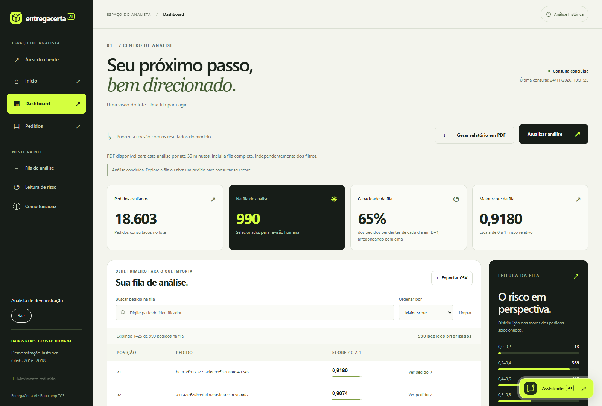
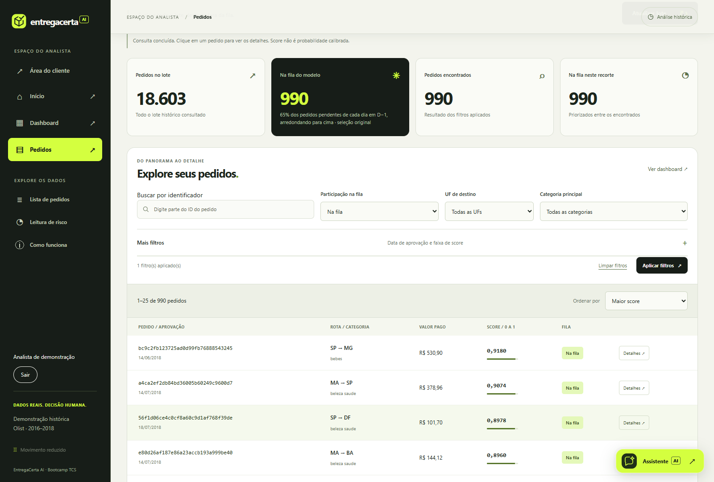

# EntregaCerta AI 📦


**IA para priorizar pedidos e apoiar o analista de logística.** Projeto em equipe desenvolvido no Bootcamp de Inteligência Artificial Aplicada em parceria com a TCS.

O EntregaCerta AI transforma dados históricos da Olist em uma fila de revisão humana: consulta os pedidos no PostgreSQL, calcula scores com CatBoost, apresenta os detalhes no dashboard e usa IA Generativa para auxiliar a interpretação e produzir relatórios em PDF. O objetivo é ajudar o analista a decidir **quais pedidos revisar primeiro**.

**Stack:** Python, Pandas, FastAPI, PostgreSQL, CatBoost, Gemini, HTML, CSS, JavaScript, Docker e Terraform. Scikit-learn e PyTorch também foram utilizados nos experimentos de ML.

[Demonstração em vídeo](https://github.com/ProjetoBootcampTCS/EntregaCerta-AI/blob/main/output/apresentacao/video%20backup.mp4) · [Slides finais](output/apresentacao/EntregaCerta_AI_apresentacao_v20.pptx) · [Arquitetura](Docs/diagramas/arquitetura.svg) · [Instalação completa](Docs/instalacao_novo_pc.md)

## O que o projeto entrega

- Dashboard exclusivo para analistas, com autenticação e autorização também no backend.
- Consulta, filtros e detalhes de pedidos; inferência real pelo modelo salvo e fila diária de prioridades.
- Assistente com contexto fornecido pela aplicação, referências às evidências e tratamento de indisponibilidade da API.
- Relatório PDF com indicadores da análise; ML, consultas e relatório básico funcionam sem chave de GenAI.
- Área do cliente e rastreamento **demonstrativos**, secundários e separados da avaliação histórica do modelo.
- Fluxo reproduzível de dados, treinamento, inferência e infraestrutura local; notebooks, testes, BPMN e DER disponíveis no repositório.

## Demonstração

Capturas da aplicação executando com o modelo salvo e registros históricos reais. A conta mostrada é exclusiva da demonstração.





O [vídeo de backup](https://github.com/ProjetoBootcampTCS/EntregaCerta-AI/blob/main/output/apresentacao/video%20backup.mp4) mostra a demonstração preparada pela equipe. Veja também um [PDF gerado pelo sistema com GenAI](output/relatorios/EntregaCerta_AI_GenAI_real_2026-11-20.pdf).

## Modelo e resultados

O **CatBoost VER0.7** recebe 111 atributos no checkpoint **D−1: início do dia anterior à entrega prometida**. Somente pedidos elegíveis ainda pendentes nesse instante recebem score. A fila seleciona 65% dos pendentes de cada dia, com arredondamento para cima; pedidos entregues antes do checkpoint aparecem como **não pontuados**.

| Resultado no teste histórico | Valor |
|---|---:|
| Pedidos do período | 18.603 |
| Pendentes em D−1 | 1.486 |
| Atrasos reais | 672 |
| Pedidos na fila de revisão | 990 |
| Atrasos encontrados | 553 |
| Recall dos atrasos | 82,29% |
| Precision da fila | 55,86% |
| F1-score | 66,55% |
| Fila / todos os pedidos | 5,32% |
| Fila / pendentes em D−1 | 66,62% |

**Limites da evidência:** o período de teste foi reutilizado durante a pesquisa, por isso os resultados são **exploratórios**, não uma avaliação independente de generalização. O score indica risco relativo, não probabilidade calibrada. D−1 oferece mais informação, mas deixa menos tempo para intervir. A demonstração não comprova atrasos evitados, ROI ou desempenho em pedidos atuais de outra operação.

Os dados Olist são registros anonimizados de 2016–2018. A área do cliente não recebe automaticamente uma previsão validada para pedidos novos. A IA Generativa auxilia a interpretação; a decisão permanece com o analista. Consulte a [documentação do modelo](Docs/modelo_ver07.md) para coortes, matriz de confusão, comparadores, fontes e limitações dos enriquecimentos.

## Instalar em um novo PC

### 1. Pré-requisitos

Instale **Python 3.12**, **Git** e **Docker Desktop**. Abra o Docker Desktop antes de preparar o banco.

### 2. Baixar e instalar

No PowerShell:

```powershell
git clone --branch main https://github.com/ProjetoBootcampTCS/EntregaCerta-AI.git
cd EntregaCerta-AI

py -3.12 -m venv .venv
.\.venv\Scripts\python.exe -m pip install -r requirements.txt
Copy-Item .env.example .env
```

A cópia do `.env` é apenas para a primeira instalação. Não sobrescreva uma configuração existente.

### 3. Configurar

No `.env`:

- Confira `POSTGRES_*` e defina sua senha local. A porta padrão é **5433**.
- Mantenha `ENTREGACERTA_MODELO=catboost_ver07` e `ENTREGACERTA_PARTICAO=teste`.
- Preencha `GEMINI_API_KEY` para utilizar o assistente.

Os CSVs necessários em `Dados/Brazilian Logistic/` e os artefatos em `Modelos/catboost_ver07/` acompanham o repositório. **O modelo já está treinado; não é necessário executar notebooks nem baixar os ZIPs de enriquecimento para abrir a demonstração.** A reconstrução dos experimentos é opcional e está no guia completo.

Nunca publique o `.env`.

### 4. Preparar o banco e criar o analista

```powershell
.\.venv\Scripts\python.exe main.py preparar-catboost
.\.venv\Scripts\python.exe main.py criar-analista --nome "Seu nome" --email "seuemail@exemplo.com"
.\.venv\Scripts\python.exe main.py verificar
```

A senha será solicitada no terminal. O cadastro público da aplicação cria somente contas de clientes.

## Executar o projeto

Com o Docker Desktop aberto, execute na raiz do projeto:

```powershell
.\.venv\Scripts\python.exe main.py iniciar
```

Acesse **http://127.0.0.1:8000**. Mantenha o terminal aberto e use **Ctrl+C** para encerrar.

### Alternativa com Terraform e Docker

Com Terraform instalado (**>= 1.14 e < 2.0**):

```powershell
.\.venv\Scripts\python.exe infra/local/gerenciar.py iniciar
```

Acesse **http://localhost:8001**. Escolha apenas uma forma de execução.

Para conferir os testes:

```powershell
.\.venv\Scripts\python.exe main.py testar --postgres
```

**Verificação em 24/11/2026:** instalação em clone limpo, ambiente Python novo e PostgreSQL vazio; **101 testes aprovados**, sem erros ou testes ignorados. Login, fila, filtros e PDF de contingência também foram conferidos pelo navegador. A API externa de GenAI não foi chamada nessa verificação. Veja os detalhes no [guia de instalação](Docs/instalacao_novo_pc.md#validacao-instalacao-limpa).

## 💡 Skills para vibe coding

As orientações de desenvolvimento assistido por IA ficam em **`.agents/skills/`**, separadas em desenvolvimento geral, frontend, GenAI e backend/infraestrutura.

Exemplo:

> Use $entregacerta-frontend para melhorar os filtros de Pedidos, preservando a intro e o ML. Confira o funcionamento.

Se a skill não aparecer na ferramenta, informe o caminho do seu `SKILL.md`. Revise e teste o código gerado.

## Organização e documentação

| Caminho | Conteúdo |
|---|---|
| `src/` e `main.py` | API, acesso, consultas, inferência e GenAI |
| `frontend/` | Interface HTML, CSS e JavaScript |
| `Notebooks/03_catboost_ver07.ipynb` | EDA, tratamento e treinamento explicado passo a passo |
| `Modelos/catboost_ver07/` | Modelo integrado, contrato, entradas e evidências de reprodução |
| `Dados/` | Dados Olist e referências dos enriquecimentos |
| `tests/` | Testes de dados, autorização, modelo, API e relatórios |
| `infra/local/` | Terraform e operação Docker local |
| `Docs/diagramas/` | Arquitetura, BPMN e DER, incluindo fontes editáveis |
| `experimentos/` e `Docs/versoes/` | Pesquisa e versões anteriores preservadas |
| `output/apresentacao/` | Slides, roteiro e vídeo de demonstração |

Comece pelo [guia de instalação](Docs/instalacao_novo_pc.md). Para entender as decisões, consulte o [modelo integrado](Docs/modelo_ver07.md) e o [registro de desenvolvimento](Docs/desenvolvimento.md), que inclui etapas históricas já substituídas.

## Equipe e créditos

Desenvolvido pela equipe [ProjetoBootcampTCS](https://github.com/ProjetoBootcampTCS). O [histórico de contribuições](https://github.com/ProjetoBootcampTCS/EntregaCerta-AI/graphs/contributors) preserva as autorias registradas no Git. Este é um projeto acadêmico da equipe, não um produto oficial da TCS ou da Olist.

| Integrante | Principais contribuições informadas pela equipe |
|---|---|
| [Nikolas Carminato](https://github.com/NikolasCarminato) | Engenharia de prompts e integrações; configuração e ajuste do assistente GenAI; frontend, design e animações; treinamento e análise de modelos; automação de processos. |
| [Pedro Henrique da Costa Silva](https://github.com/Pedrh316) | Análise exploratória e tratamento de dados; treinamento de modelos; registro e organização dos testes de diferentes modelos; automação de processos. |
| [Murilo Carvalho Silva](https://github.com/Naoakibb) | Treinamento e validação do modelo de machine learning. |
| [Matheus Assalin](https://github.com/MathDeMarco) | Treinamento e validação do modelo de machine learning. |

A tabela registra a divisão atual do trabalho e pode ser atualizada pela equipe. Algumas atividades foram realizadas em conjunto; o histórico de commits não representa sozinho toda a contribuição de cada integrante.

## Dados e condições de uso

O **código original da equipe** é disponibilizado sob a [licença MIT](LICENSE), conforme o [texto de referência da Open Source Initiative](https://opensource.org/license/mit). Essa licença não substitui as condições dos datasets, dos dados transformados, dos artefatos treinados nem dos materiais e dependências de terceiros. A presença desses arquivos no repositório não os coloca automaticamente sob MIT.

| Fonte | Uso e condições documentadas |
|---|---|
| [Brazilian E-Commerce Public Dataset — Olist](https://www.kaggle.com/datasets/olistbr/brazilian-ecommerce) | Pedidos reais anonimizados; CC BY-NC-SA 4.0. Os dados foram consolidados e transformados para o estudo. |
| [Marketing Funnel — Olist](https://www.kaggle.com/datasets/olistbr/marketing-funnel-olist) | Características comerciais dos vendedores; CC BY-NC-SA 4.0. |
| [Matriz rodoviária — Raphael Saldanha / Zenodo](https://doi.org/10.5281/zenodo.11400243) | Estimativas de distância e duração; CC BY 4.0. Rede de maio/2024, posterior aos pedidos. |
| [INMET](https://portal.inmet.gov.br/dadoshistoricos/) e [IBGE](https://www.ibge.gov.br/explica/codigos-dos-municipios.php) | Fontes declaradas dos CSVs preparados de clima e municípios; a origem bruta desses recortes não foi reauditada integralmente. Consultar as condições do publicador. |

Fontes, downloads e distinções entre dados brutos e preparados estão em [fontes dos enriquecimentos](Dados/Datasets%20para%20Enriquecimento/fontes_datasets.txt) e [recebimento da base Olist](Docs/recebimento_dataset.txt). As transformações da equipe não tornam os dados originais nem seus derivados registros de autoria própria.

## Versão apresentada

A branch `main` reúne a versão final e os ajustes de documentação. A tag [`apresentacao-final`](https://github.com/ProjetoBootcampTCS/EntregaCerta-AI/tree/apresentacao-final) preserva o commit da apresentação; `rnn-train` mantém o histórico da branch de desenvolvimento. As versões anteriores permanecem disponíveis sem exigir sua execução para usar a aplicação.
